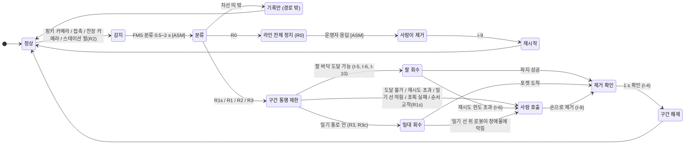
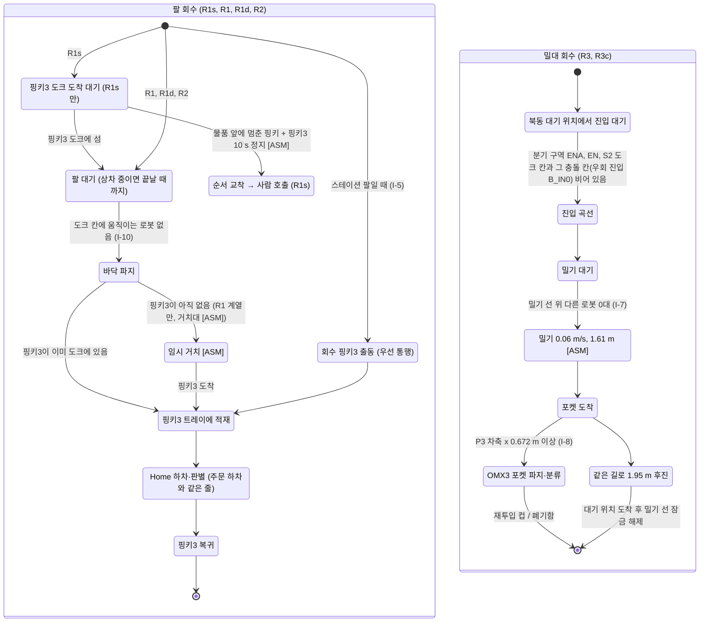
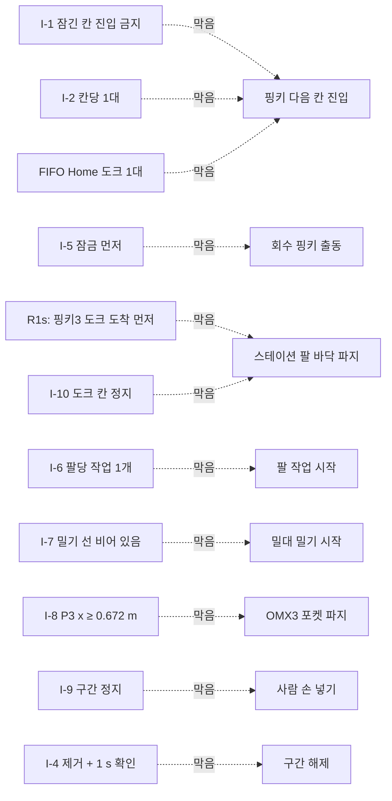

# 장애물 회수 FSM과 인터락 (PRD_v2 §4 + 제안 옵션)

> 이 그림은 `src/prd2_des/engine.py`가 실제로 돌리는 상태와 전환이다. 하드웨어에서 확인한 것은 하나도 없다.
> R0 = 라인 전체 E-STOP 비교 기준, **R1s = PRD_v2 문면대로**(지나가는 핑키 카메라 감지 + 회수 핑키3이 도크에 선 뒤 스테이션 팔 바닥 파지),
> **R1 = R1s + 임시 거치대 [ASM, PRD_v2에 없음]**(핑키3이 아직 없으면 팔이 물품을 받침 위 거치대에 먼저 둠 — 이전 판에서 'PRD_v2 그대로'라고 잘못 부름), R1d = R1 + 우회 차선,
> R2 = R1 + 상차 중 떨어진 물품을 그 스테이션 팔이 바로 다시 집기, R3 = 제안(천장 카메라 + 밀대 + Home 회수 포켓, **팀 결정 아님**),
> R3c = R2 + R3 + OMX3 직접 바닥 파지.
> "E-STOP 0"은 제한 구간 밖의 라인이 계속 돈다는 뜻이다. 물리 비상정지(팔별 12 V 차단 + ALL-STOP)는 그대로 둔다 (I-11).

## 1. FMS 상태 (장애물 1건 기준)

## 2. 회수 경로별 하위 상태

## 3. 인터락: 무엇이 어떤 전환을 막는가

| ID | 막는 전환 | 조건 (모두 참이어야 통과) | 모델에서 검사하는 곳 | 고장 주입 시험 |
|---|---|---|---|---|
| I-1 | 로봇이 다음 칸으로 들어가기 | 그 칸에 걸린 잠금이 없거나, 잠글 때 이미 안에 있었고 그 뒤 잠긴 구역을 한 번도 벗어나지 않았거나(v2: 벗어나면 권한 상실, 다시 못 들어옴), 회수 핑키(P3)다 | `Sim.available`, `Sim.release`, monitor `I1_lock_entry` | 있음 (`break_ignore_locks`) |
| I-2 | 로봇이 다음 칸으로 들어가기 | 그 칸과 충돌 칸에 다른 로봇이 없다. 앞 로봇 뒤끝이 경계에서 0.05 m 지나야 뒤 칸을 놓는다. 충돌 칸은 손으로 적지 않고 몸체 다각형으로 계산(v2/v3): 우회 진입 분기 B_IN0 ↔ 북동 모퉁이 분기 구역 ENA, 우회 진입 B_IN ↔ S2→우회 곡선 B_X2, 우회→S1 곡선 B_M1 ↔ B_X2 / 우회 중간 B_MID / 우회 차선 B_W / 스테이션 차선 ST_M, B_MID ↔ B_X2, B_X2 ↔ ST_M, 우회→스테이션 합류 B_M2 ↔ ST_W | `Sim.available`, `geometry.GEOM_CONFLICTS`, monitor `I2_cell_exclusive` | 있음 (`break_no_cells`) |
| I-3 | (감시만) | 몸체끼리 겹치지 않는다. P3+밀대는 몸체+V 밀대 외곽으로 본다. 0.2 s 간격 표본 | monitor `I3_collision` = PRD "핑키 간 충돌 0"의 대리 지표 | 있음 (`break_no_cells`) |
| I-4 | 구간해제 | 장애물이 바닥을 떠났고 1 s 확인을 마쳤다. 같은 장애물의 잠금들이 빈틈 없이 이어진다 | `zone_release`, monitor `I4_release_after_clear` | 있음 (`break_early_release`) |
| I-5 | 회수 핑키 출동 | 구간 잠금이 먼저 걸려 있다 | `r1_recover`, `PlowMission`, monitor `I5_dispatch_after_lock` | 있음 (`break_dispatch_before_lock`, 수정판에서 추가) |
| I-6 | 팔 작업 시작 | 그 팔에 다른 작업이 없다. OMX3 순위: 바닥 회수 0 > 주문 하차 1 > 포켓 분류 2. 파지 재시도 한도 1회 [ASM] | simpy `PriorityResource`, monitor `I6_arm_exclusive` | **없음 — 감시만** |
| I-7 | 밀기 시작 (및 P3 출동) | 밀기: S1·S2 도크, 스테이션 차선, Home 대기 자리, 북서 곡선, 우회 합류 곡선에 다른 로봇이 없다. 출동: 밀대 외곽이 진입 곡선에서 겹치는 칸(ENA, EN, S2 도크)과 그 충돌 칸이 비어 있다. 밀기 잠금은 ENA까지 덮는다(v3: 빠뜨리면 교착) | `PlowMission.run`, `geometry.P3_ENTRY_ZONE`, monitor `I7_push_clear` | 있음 (`break_push_no_wait`) |
| I-8 | OMX3 포켓 파지 | P3 차축 x ≥ 0.672 m (OMX3 최대 도달 0.355 m 밖) [MODEL task A] | `PlowMission.pocket_sort`, monitor `I8_pocket_clear` | 있음 (`break_omx3_no_wait`) |
| I-9 | 사람 손 넣기 | 그 구간(R0은 전체)에서 움직이는 로봇이 없고, 손이 들어간 동안 구간 안 로봇은 멈춘다 | `human_fallback`, `r0_estop`, monitor `I9_hands_in` | **없음 — 감시만** (검토 r2: pause·moving_in 대기를 빼 봐도 위반이 안 났음) |
| I-10 | 스테이션 팔 바닥 파지 | 그 팔의 도크 칸에서 움직이는 로봇이 없다 | `r1_recover`, monitor `I10_floor_pick` | **없음 — 감시만** (검토 r2: moving_in 대기를 빼 봐도 위반이 안 났음) |
| I-11 | (모델 밖) | 물리 비상정지(팔별 12 V 차단 + ALL-STOP)는 항상 살아 있다 | 하드웨어 규칙, 시뮬레이션 안 함 | 해당 없음 |
| FIFO | 북서 곡선 진입 | Home 도크가 비어 있다 (먼저 온 핑키부터 1대씩 하차, PRD_v2 §3-6) | `Sim.available` (NW 규칙) | 없음 |
| 밀기 선 막힘 | 밀기 대기 → 사람 호출 | 밀기 선 위에서 장애물 앞에 멈춘 주문 핑키가 있다 (그 핑키가 비켜야 밀 수 있는데 장애물 때문에 앞으로 못 가고, 후진은 모델에 없음). 결과 이름 `push_blocked` | `PlowMission.stuck_upstream` | 없음 (결과 분류) |

일부러 망가뜨린 모델 6개(잠금 무시, 칸 점유 무시, 장애물 제거 전 해제, 잠금 없이 회수 핑키 출동, 밀기 선 확인 없이 밀기, P3가 팔 반경 안에 있는데 포켓 파지)는 모두 감시기가 위반으로 잡는다. 확인은 두 겹이다: `test_breakage_*` 6개는 "위반 수 > 0"을 확인하고(통과해야 함), `test_must_fail_*` 6개는 정상 정책과 똑같은 "위반 0" 검사를 망가뜨린 모델에 돌려 **반드시 실패**해야 한다 (pytest `xfail(strict=True)`: 만약 통과하면 시험 묶음 전체가 실패). **I-6·I-9·I-10은 감시기가 로그로 다시 계산하지만 그 감시가 실제로 위반을 잡는지 보여 준 고장 주입 시험이 없다** — 이 셋의 '위반 0'은 증거가 약하다. 최종 규칙(v3, 검토 r2 수정판) 실행 결과: **54 passed, 6 xfailed in 111.37s (0:01:51)** (회귀 시험 포함, report.md 참조).

**규칙 이력** — v1(같은 차선 앞뒤 + 손으로 적은 교차 3쌍)은 Monte Carlo 24 000회 중 194회에서 감시기가 몸체 겹침·재진입을 찾았다. v2(충돌 쌍 기하 계산, 재진입 금지, 감지 실패 처리 수정)는 그것을 없앴지만 밀대 제안에서 교착 44회 + 겹침을 새로 만들었다. v3(우회 분기 칸 분리, 밀기 잠금에 ENA 포함, P3 출동 조건에 충돌 칸 포함)가 최종이다.

## 4. 인터락 → 상태 전환 대응 (한눈에)

