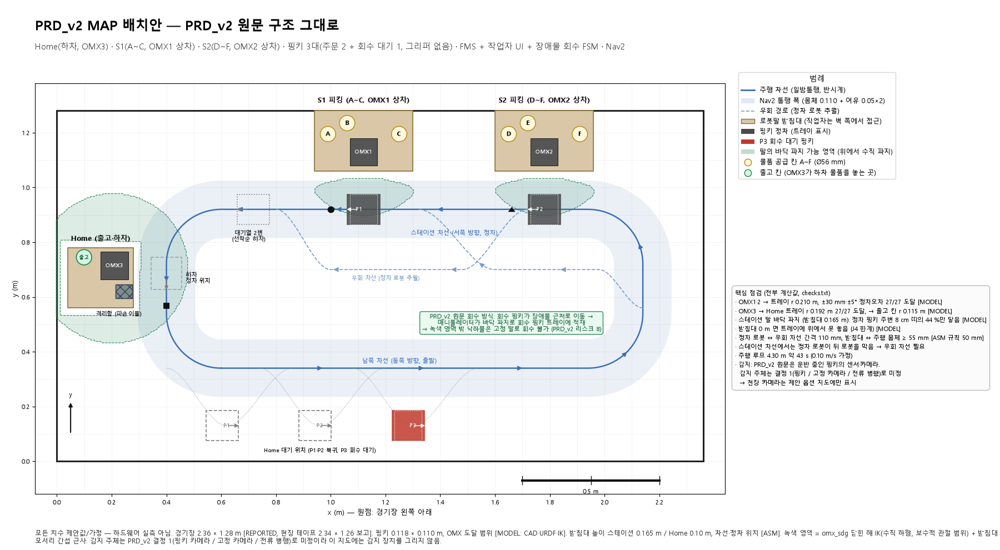
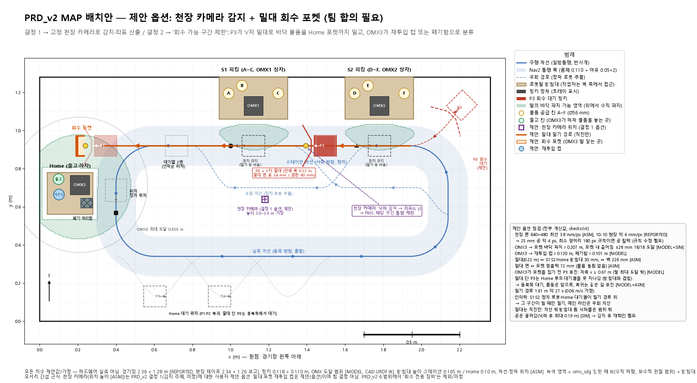
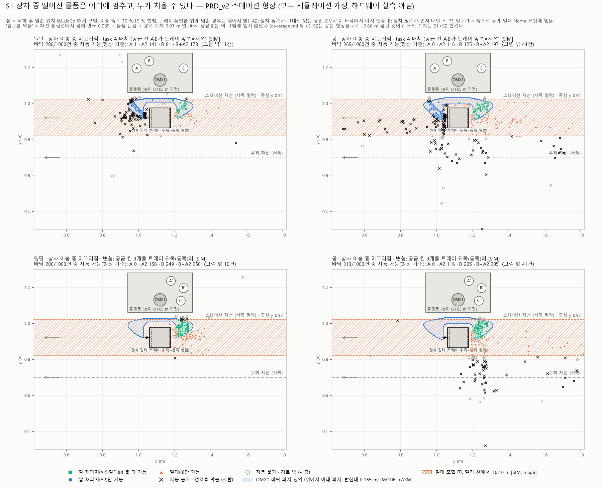
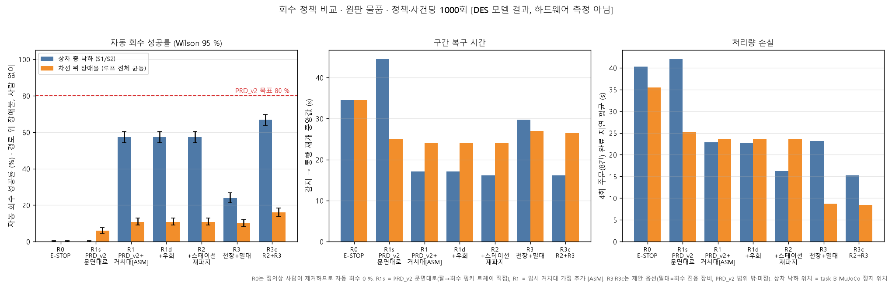
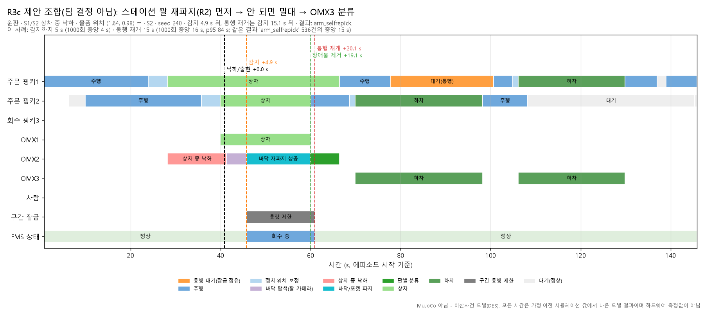

# PRD_v2 · 장애물 회수 · 관제·회수 FSM 제안 및 검증 분석서

> **작성자**: 강건한 (Pinky_Team4)  
> **관련 문서**: [FSM 상태머신 다이어그램](../architecture/fsm-state-diagram.md) | Confluence 기술 분석서 [2916354](https://pinkyteam4.atlassian.net/wiki/spaces/PinkyTeam4/pages/2916354)  
> **검증 기반**: MuJoCo 24,000회 물리 시뮬레이션 및 SimPy 이산사건(DES) 기구학적 검증 모델  
> *주의: 본 문서의 수치는 하드웨어 실측값이 아니며, 시뮬레이션 및 설계 계산치입니다. 밀대 및 회수 포켓은 팀 제안 옵션입니다.*

---

## 1. 한눈에 보는 핵심 판정 4대 요약

1. **PRD_v2 원안은 상차 중 낙하 시 기구학적 순서 교착(Kinematic Deadlock)이 발생합니다.**
   - 스테이션 팔이 바닥에서 집어 회수 핑키에 싣는 방식은 팔이 닿는 바닥이 정차 핑키 바로 앞·옆·뒤이므로, 정차 핑키가 출발하지 못하거나 회수 핑키가 해당 위치에 진입하지 못합니다.
   - **자동 회수 성공률**: 원판 1/548 (0.2%), 공 1/718 (0.1%)로 사실상 자율 회수 불가 [SIM].

2. **상차 팔이 바닥 낙하물을 '즉시 재파지'하면 약 50% 자율 해결됩니다.**
   - 정차 핑키를 세운 채 스테이션 팔이 바닥에서 다시 집어 해당 핑키에 적재: 원판 271/548 (49%), 공 217/718 (30%).
   - 회수 핑키를 급파할 필요 없이 즉시 정상 사이클로 복귀 가능합니다 [SIM].

3. **공급 칸을 트레이 뒤쪽에 두고 밀대+Home 포켓을 적용하면 85% / 62% 달성됩니다.**
   - 공급 칸이 트레이 앞쪽이면 떨어진 물품이 출발 경로를 가로막습니다. 뒤쪽(핑키 진입 방향)에 배치하고 V자 밀대 + Home 포켓 조합을 활용하면 회수 성공률이 대폭 상승합니다.
   - **원판**: 481/570 (84%) 회수 (재파지와 병용 시 85%)
   - **구형(공)**: 367/599 (61%) 회수 (재파지와 병용 시 62%)

4. **정차 핑키 바로 옆 낙하는 천장 카메라 사각지대입니다.**
   - 바닥 낙하의 절반 가량(원판 47%, 공 43%)이 정차 핑키 몸체 7cm 이내에 정지합니다.
   - 따라서 천장 카메라 단독 감지로는 한계가 있으며, **로봇팔 신호(그리퍼 전류/각도 리밋) 기반으로 낙하를 즉시 감지하여 정차 핑키의 출발을 보류하는 FSM 인터락**이 필수적입니다.

---

## 2. 경기장 MAP 레이아웃 및 하드웨어 기구학 검증 (2.36 × 1.28 m)

### 2.1. PRD_v2 원문 배치 vs 제안 옵션 배치

| PRD_v2 원안 배치도 | 제안 옵션 배치도 (밀대 + Home 포켓) |
|:---:|:---:|
|  |  |

* **PRD_v2 원안**: 북쪽 벽 S1(OMX1), S2(OMX2) 및 서쪽 벽 Home(하차 OMX3). 일방통행 반시계 루프이며, 정차 로봇 뒤를 추월하기 위한 우회 차선이 명시됨.
* **제안 옵션**: 천장 카메라 감지와 함께 회수 핑키(P3)가 V자 밀대(유효 전폭 0.22 m)로 북쪽 차선 낙하물을 서쪽 직선 경로로 밀어 Home 포켓에 안착시키고, OMX3가 재투입 또는 폐기로 자동 분류. 밀대 장착 P3는 북동 대기소에서 대기.

### 2.2. 로봇팔 바닥 도달 반경 및 커버리지 맵

### 2.3. 기구학 및 도달성 검사표

| 확인 항목 | 값 | 근거 |
|---|---|---|
| OMX1·2 → 정차 트레이 (정차 오차 ±30 mm, ±5°) | 27/27 자세 도달, 여유 ≥ 27 mm | MODEL |
| OMX3 → Home 트레이 · 출고 칸 · 격리함 | 27/27 · r 0.115 m · r 0.101 m | MODEL |
| 스테이션 팔 바닥 파지 범위 (받침대 0.165 m) | 반경 0.100–0.237 m, 정차 핑키 주변 8 cm 띠의 44% | MODEL ASM |
| 정차 핑키가 뒤 핑키를 막음 (스테이션 차선 한 줄) | 막음 → 우회 차선 필요 여부 검증 | MODEL |
| 천장 카메라 (팀 폰 640×480, 높이 2.0–2.3 m) | 3.8–6.4 mm/px (현장 실측치 약 6 mm/px) | ASM REPORTED |
| 최소 덩어리 180 px 규칙 시 감지 가능 크기 | 32 / 65 / 91 mm (2.1 / 4.3 / 6.0 mm/px) | 지름 20–30 mm 공은 필터링 위험 |
| 제안: OMX3 → 포켓 바닥 파지 (포켓 내 ±28 mm 확산) | 18/18 도달, 여유 ≥ 25 mm | MODEL SIM |
| 제안: 밀대 밀기 거리 및 소요 시간 (0.06 m/s) | 1.61 m 직선 주행 · 약 27초 | ASM |

---

## 3. 회수 방식 정밀 비교 (상차 중 바닥 낙하 시)

| 낙하 조건 | 바닥 낙하 / 해제 | 원안 (팔 → 회수 핑키) | 스테이션 팔 즉시 재파지 | 밀대 + 포켓 (제안) | 밀대 + 재파지 병용 |
|---|:---:|:---:|:---:|:---:|:---:|
| 원판 · 공급 칸 앞쪽 (원안 배치) | 548/2000 | 1 (0.2%) | 271 (49%) | 156 (28%) | 334 (61%) |
| 공 · 구형 공급 칸 앞쪽 | 718/2000 | 1 (0.1%) | 217 (30%) | 201 (28%) | 336 (47%) |
| 원판 · 공급 칸 뒤쪽 (제안 변형) | 570/2000 | 0 (0%) | 307 (54%) | 481 (84%) | 482 (85%) |
| 공 · 구형 공급 칸 뒤쪽 (제안 변형) | 599/2000 | 5 (0.8%) | 209 (35%) | 367 (61%) | 369 (62%) |

> *참고*: 기본 평판 패드 대비 20° 쐐기형 패드 장착 및 적도 높이 파지 + ±30mm 카메라 오차 보정을 적용했을 때의 시뮬레이션 결과입니다.

---

## 4. 자가치유 FSM 정책 비교 (이산사건 24,000회 시뮬레이션)

| 정책 코드 및 구성 | 상차 낙하 자동 회수 (원판 / 공) | 감지 소요 시간 (중앙값) | 통행 정상화 (중앙값) | 라인 전면 E-STOP | 차선 위 장애물 자동 회수 |
|---|:---:|:---:|:---:|:---:|:---:|
| **R0 기준안** (라인 전면 정지 + 작업자 수동) | 0 / 0 | 28 s | 35 s | 919/1000 | 0/1000 |
| **R1s PRD_v2 원안 문면대로** (팔 → 회수 핑키) | 0/1000 / 2/1000 | 28 s | 44 s | 0 | 59/1000 (6%) |
| **R1 원안 + 임시 거치대 추가** | 536/1000 (54%) / 392/1000 (39%) | 28 s | 17 s | 0 | 108/1000 (11%) |
| **R2 R1 + 스테이션 팔 즉시 재파지** | 536/1000 (54%) / 395/1000 (40%) | 4.5 s | 16 s | 0 | 108/1000 (11%) |
| **R3 천장 카메라 + 밀대 단독** | 224/1000 (22%) / 257/1000 (26%) | 25 s | 30 s | 0 | 102/1000 (10%) |
| **R3c 추천 복합안 (재파지 ➜ OMX3 ➜ 밀대 ➜ 사람)** | **624/1000 (62%) / 514/1000 (51%)** | **3.8 s** | **16 s** | **0회 (무중단)** | **160/1000 (16%)** |

### 4.1. 정책 비교 차트 및 타임라인

| 정책별 성능 비교 분석 | 추천안 R3c 타임라인 (16초 정상화) |
|:---:|:---:|
|  |  |

### 4.2. 핵심 시뮬레이션 분석 결론
1. **우회 차선은 효용성이 거의 없습니다 (1,000회 시뮬레이션 중 결과 변경 4~6회에 불과)**: 
   복잡한 우회 경로를 동적 스케줄링하는 대신, **"장애물 구간 잠금 후 뒤 핑키 일시 정지(Hold)"** 방식을 취하는 것이 시스템 복잡도를 낮추고 안전성을 보장합니다.
2. **차선 위 주행 장애물은 현실적으로 84~94% 작업자 개입이 필요합니다**:
   팔이 닿는 차선은 전체 트랙의 11%에 불과하며, 남쪽 직선로(전체의 47%)는 어떤 로봇팔도 닿지 않습니다. 따라서 완전 무인화 과장보다는 '안전 통제 하 사람 호출'이 현실적입니다.
3. **E-STOP 0회 & 차체 충돌 0회 달성**:
   단순 앞뒤 차선 차단 시 분기/합류 지점에서 194회 겹침이 발생했으나, **분기·교차·합류 충돌 칸(I-2 인터락)**을 도입하여 24,000회 전수 시뮬레이션에서 위반 0건을 달성했습니다.

---

## 5. 핵심 안전 통제 인터락 규칙 (I-1 ~ I-11)

상세 상태 다이어그램 및 전환 조건은 [docs/architecture/fsm-state-diagram.md](../architecture/fsm-state-diagram.md)를 참고하십시오.

* **I-1 (구간 진입 통제)**: 잠긴 구간 진입 금지 (회수 핑키 제외). 구역을 이탈한 일반 로봇은 재진입 불가.
* **I-2 (칸 배타적 점유)**: 분기/교차/합류 지점의 기하 충돌 칸에 타 로봇 존재 시 진입 차단.
* **I-3 (차체 비간섭 감시)**: V자 밀대를 포함한 차체 외곽선 간 간섭 0 유지.
* **I-4 (구간 잠금 해제)**: 장애물이 바닥에서 완전히 제거된 후 1초간 유지 확인 후 해제.
* **I-5 (회수 핑키 출동 선행)**: 회수 대상 구간의 잠금이 선행되어야만 회수 로봇 출동 승인.
* **I-6 (로봇팔 작업 배타성)**: OMX3 우선순위: 바닥 긴급 회수(0) > 주문 하차(1) > 포켓 분류(2).
* **I-7 (밀대 주행로 확보)**: S1, S2 도크 및 북쪽 직선로, 합류 곡선로가 완전히 비어있을 때 밀기 개시.
* **I-8 (포켓 파지 안전 거리)**: P3 차축 위치 $x \ge 0.672\text{ m}$ 확보 시에만 OMX3 포켓 파지 시작.
* **I-9 (작업자 개입 안전)**: 사람 손 진입 시 해당 구간 내 모든 로봇 강제 정지.
* **I-10 (바닥 파지 도크 정지)**: 도크 칸 내 로봇의 주행 모션이 완전 정지된 상태에서만 바닥 파지 수행.
* **I-11 (물리적 비상 정지 보존)**: 소프트웨어 통제와 별개로 하드웨어 12V 전원 차단 스위치는 상시 독립 유지.

---

## 6. 오늘 저녁 19:30 회의 안건별 제안 사항

1. **감지 주체 및 좌표 전달**:
   - 상차 낙하: 스테이션 로봇팔 신호(그리퍼 전류/각도 리밋) 기반 즉각 감지.
   - 주행로 낙하: 천장 고정 카메라(Overhead Cam) 기반 바닥 그리드 좌표 추출.
   - 공통 FMS 관제 서버로 `fleet_msgs/msg/DropEvent` 토픽 발행.
2. **바닥 물체 회수 주체**:
   - 1차: 상차 팔 즉시 재파지 시도.
   - 2차 (도달 불가 영역): 회수 핑키(P3) V자 밀대로 Home 회수 포켓으로 이송.
   - 3차: 작업자 알림 후 수동 안전 조치.
3. **회수 중 트래픽 제어**:
   - 비효율적인 우회 주행로 신설 대신 **"해당 블록 구간 잠금 + 후속 핑키 대기(Hold)"** 정책 확정.
4. **팀 내 역할 분담 (제안)**:
   - **강건한**: 천장 비전 스트리밍 및 낙하 좌표 추출, 관제 중계 브릿지, 자율 회수 FSM 인터락 엔진 및 Sim-to-Real 갭 검증.
   - **김지혜**: 관제 웹 UI/대시보드 프론트엔드 연동.
