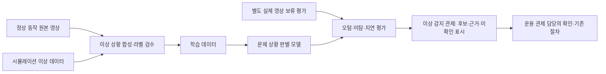

# 관제 담당 분리와 항공뷰 최소 목표

- 기준: 2026-10-24 사용자 회의 후 지시. 관제를 두 영역으로 나누며 로봇 기능 자체는 별도 담당자가 개발한다.
- 상태: 관제 분리 방향과 항공뷰 목표는 사용자 지시를 반영했다. 개인 담당자는 사용자 지정으로 확정했다. 클래스 정의·성능 임계 등 기술 결정은 아직 미정이다. [팀 담당표](team_roles.md)를 따른다.
- 정본: 메뉴별 `control_area`·`control_owner`는 `src/cobot_gui/config/menu_tree.yaml`. 전체 배정표는 생성 문서 `fms_menu_tree.md`에만 둔다.

## 두 관제 영역

| 영역 | 관제 구현 역할 | 맡는 일 | 맡지 않는 일 |
|---|---|---|---|
| 로봇 수행 관제 | operation_control, 김지혜 | 주문·미션·배정·주행/팔 작업의 요청·진행·결과, 운용 모드·정지 요청·복구 절차 UI | Nav2·팔 모션·장치 드라이버·로봇 기능 자체 구현 |
| 이상 감지 관제 | anomaly_monitoring, 강건한 | 항공뷰 문제 상황 후보, 알림·판별 근거, 카메라·통신·프로세스·로그 이상 관찰, 평가 결과 조회 | 기능 수행 명령의 별도 발행 경로, 학습 성공을 운영 안전 승인으로 바꾸는 일 |

이는 '로봇 개발팀 대 인프라팀' 구분이 아니다. 로봇 기능 개발은 기존 주행·팔·비전 등 별도 담당에 남고 **관제 구현 책임 자체**를 두 갈래로 나눈다. 인프라 모니터링은 이상 감지 관제의 한 부분이다.

- `control_owner`: 두 관제 중 해당 메뉴의 결과물을 완성할 책임 역할.
- `screen_owner`: 실제 화면 구현 담당. 웹은 해당 관제 역할을 기본으로 한다. Station PC의 기존 3.7 앱은 manipulation을 유지하고 운용 관제는 앱 안내·상태 요약 연결만 맡는다.
- `data_owner`: 기존 기능/데이터 계약 담당. 이것만으로 해당 담당자에게 새 관제 화면이나 모델·시뮬 개발까지 할당한 것이 아니다.
- 공통 GUI 셸·인증·데이터 연결은 재사용한다. 페이지, 서버, 명령 발행 코어를 두 벌로 만들지 않는다.

## 항공뷰의 변경된 목표

항공뷰는 **문제 상황 여부 판별**에 집중한다. 후보는 다음 세 가지이며 클래스 범위·라벨 정책·정체 시간·점수 임계는 확정하지 않았다.

1. 충돌·접근 위험: 실제 접촉과 단순 접근을 같은 확정 라벨로 처리하지 않고 정의를 먼저 정한다.
2. 박스 낙하: 정상 상하차 동작·손/그림자·일시 가림과 구분한다.
3. 장시간 정체: 정상 대기·도킹·상하차와 비정상 정체를 구분한다. 기준 시간은 미정이다.

항공뷰에서 로봇의 정밀 위치 추적, 도킹 완료 확인, 통로 퇴장(Tail Exit)의 제어 증거를 새로 구현하는 것은 이번 최소 목표에서 제외한다. 지도에는 로봇이 보고하는 위치를 사용한다. 기존 기능 수행에 필요한 퇴장·도킹 증거가 있다면 로봇 기능 담당이 별도 수단을 합의해야 하며, 미계측을 이상 모델의 '정상' 결과로 대체하지 않는다.

## 시뮬레이션·정상 영상 합성 학습 계획

- 원본 정상 영상은 보존한다. 합성본에는 원본 클립/세션 ID, 시뮬 시나리오·버전·seed, 합성 방법·파라미터, 라벨 작성자·버전·시각을 남긴다. 실제 촬영·시뮬·합성·평가 데이터를 식별할 수 있어야 한다.
- 같은 원본 영상에서 파생된 합성본과 근접 프레임을 학습/검증/시험에 나누어 넣지 않는다. 원본 클립·세션 단위로 분리한다.
- 실제 정상 영상의 보류 세트로 오탐을 확인한다. 실제 이상 영상의 안전한 수집/기존 자료가 없으면 실제 이상 미탐률은 UNKNOWN으로 남긴다. 가짜 이상만으로 현장 재현율을 보고하지 않는다.
- 오탐·미탐은 해당 평가의 k/n·Wilson 95% 구간과 출처를 함께 기록한다. 모델 버전·입력 지연·판별 지연도 구분한다. 합성 검증 수치와 실제 영상 평가 수치를 합치지 않는다.
- 모델/합성 데이터/평가는 비전·시뮬 담당이 제공하는 별도 결과물이다. 이상 감지 관제는 그 상태와 근거를 보여준다. 이번 변경은 모델 학습이나 배포를 실행한 것이 아니다.

## 화면과 인터페이스의 최소 범위

- 운용 관제: 기존 1.1·2.1·3.7 화면을 재사용하고, 필요한 작업 요청·진행·결과 연결부터 한다. 새 자동 배정 최적화·원격 텔레옵 확대는 별도다.
- 이상 감지 관제: 기존 1.4·4.1·6.2에 상태를 붙이고, 4.3은 세 후보의 목록·시각·근거·미확인 상태부터 만든다. 6.5에는 합성/실영상 평가 출처를 연결한다.
- 웹 라벨링 작업대, 장기 영상 저장소, 상세 통계 화면을 모두 먼저 만드는 것은 최소 범위 밖이다. 데이터 준비는 기존 도구/파일 산출물을 재사용한다.
- 기존 VisionEvent를 새 모델 출력과 같다고 가정하지 않는다. 소스 종류·모델 버전·후보 종류·입력 시각·평가 상태의 표현은 계약 초안으로 별도 리뷰한다. 이번 변경은 msg/srv/action을 바꾸지 않는다.
- 입력 없음·오래된 입력·미확인·문제 후보를 정상으로 묶지 않는다. '정상 후보'는 물리 작업 완료나 제어권 승인 증거가 아니다. 분류 결과만으로 정지·출발·회수 명령을 자동 발행하지 않는다.

레지스트리 스키마는 2로 올렸다. 두 관제 필드가 없는 옛 스키마는 새 검사기에서 거부하며 문서·웹 생성물을 함께 갱신한다.

## 인계와 다음 결정

김지혜(로봇 수행 관제)와 강건한(이상 감지 관제)은 레지스트리에서 자기 영역 메뉴와 `data_owner`를 확인한다. 로봇 기능 담당은 데이터 계약·기능 완료 증거를, 이상 모델 담당은 데이터 출처·평가 결과를 제공한다. 공통 파일 변경은 registry/common 브랜치에서 조정한다. 각 메뉴의 기존 phase는 기술·안전 통합 조건이며 관제 담당 배정이나 병렬 화면 작업을 금지하는 일정표가 아니다. 실물 활성화 조건은 생략하지 않는다.
