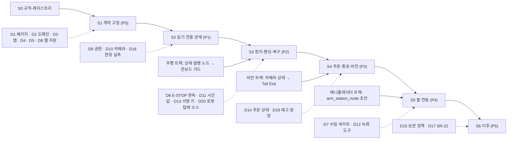

# FMS 관제 대시보드 전체 순차 계획 (S0~S6)

- 상태: 초안 (2026-10-22). 팀 리뷰 전이다.
- 근거: FMS 관제 대시보드 아키텍처 설계서 v0.1 §9 (레포 밖 초안), 메뉴 레지스트리 `src/cobot_gui/config/menu_tree.yaml`, 규칙 [`docs/fms_dev_rules.md`](fms_dev_rules.md).
- 설계서는 아직 팀에 공개하지 않은 초안이다. 본문의 '설계서 §x' 는 출처 표시다. 출구 검사 항목은 이 문서에 직접 적었다.
- 날짜: 미정(D21). Sprint 날짜를 받은 뒤 넣는다.
- 메뉴 목록의 정본은 레지스트리다. 이 문서의 단계 제목(`### S2 읽기 전용 관제 (P1)` 꼴)과 '포함 메뉴' 줄은 시험(`test_roadmap_stage_menus_match_registry`)이 레지스트리의 `phases`·`phase` 와 대조한다. 단계 이름이나 메뉴의 단계를 바꾸려면 레지스트리와 이 문서를 같은 PR 에서 고친다.
- 단계 이름: 로드맵의 S1 부터 S6 까지는 설계서·레지스트리의 P0 부터 P5 까지와 같다 (S1 = P0, S2 = P1, … S6 = P5). S0 은 이번 규칙·레지스트리 작업이다.

## 1. 한눈에 보기

| 순서 | 단계 | 레지스트리 phase | 주 담당 | 날짜 |
|---|---|---|---|---|
| S0 | 규칙·레지스트리 | — | 관제·GUI | 미정(D21) |
| S1 | 계약 고정 | P0 (메뉴 없음) | 관제 + 전 트랙 리뷰 | 미정(D21) |
| S2 | 읽기 전용 관제 | P1 | 관제·GUI | 미정(D21) |
| S3 | 정지·펜싱·복구 | P2 | 관제 + 주행 | 미정(D21) |
| S4 | 주문·통로·비전 | P3 | 관제 + 비전 | 미정(D21) |
| S5 | 팔 연동 | P4 | GUI + 매니퓰레이터 | 미정(D21) |
| S6 | 이후 | P5 | 항목별 담당 | 미정(D21) |

원칙:

- 단계마다 실패할 수 있는 출구 검사를 둔다. skip 은 통과가 아니다.
- 단계 안에서는 메뉴 단위로 나눠 병렬로 한다.
- 단계를 건너뛰지 않는다. 앞 단계 출구 검사를 통과하기 전에는 다음 단계 메뉴를 시작하지 않는다.
- 일정이 빠듯하면 우선순위는 S3 > S4 > S5 다 (설계서 §9).
- 규모(인일)는 아직 잰 적이 없다. 담당자와 다시 정한다.

## 2. 의존 그림

실선은 '먼저 끝나야 한다', 점선은 '이 결정을 기다린다' 이다.

## 3. 단계별 상세

### S0 규칙·레지스트리 (이번 PR)

- 목표: 공통 규칙과 메뉴 레지스트리를 먼저 깔아서, 같은 메뉴를 두 사람이 따로 만드는 일을 막는다.
- **포함 메뉴**: 없음 (34개 전체를 등록만 한다)
- 주 담당: 관제(`control_center`)·GUI(`gui`)
- 같이 해도 되는 일: 각 역할 담당이 레지스트리의 자기 담당 칸(`screen_owner`·`data_owner`)을 확인한다.
- 먼저 끝나야 하는 것: 없음
- 기다리는 결정: 없음. 관련 결정은 D16(Git 규칙·CODEOWNERS), D17(메뉴 문서 정정).
- 출구 검사:
  1. `PYTHONPATH=src/cobot_gui python3 -m pytest src/cobot_gui/test/test_menu_registry.py` 가 통과한다. 시험 안의 음성 대조(SR-22 주입, SR 이름 변경, 메뉴 삭제, 없앤 메뉴에 화면 주기 등)는 검증 함수가 오류를 내야 통과한다.
  2. `PYTHONPATH=src/cobot_gui python3 -m cobot_gui.menu_registry` 가 오류 0 이다. YAML 에서 메뉴를 하나 지우거나 SR 이름을 바꾸면 1 이어야 한다.
  3. `PYTHONPATH=src/cobot_gui python3 -m cobot_gui.gen_menu_doc --check` 가 0 이다. 생성 문서를 한 글자 고치면 1 이어야 한다.
  4. 깨끗한 Jazzy 환경에서 `colcon build --packages-select cobot_gui` 와 `colcon test --packages-select cobot_gui`(flake8·pep257·copyright 포함)가 실패 0, skip 0 으로 통과한다.
  5. PR 이 1명 이상 리뷰를 받고 머지된다. 각 역할이 담당 칸 초안을 확인한 기록(리뷰 댓글)이 있다.
- 이번 PR 에서 미룬 것:
  - `.github/CODEOWNERS`: 팀원의 GitHub 계정을 확인한 뒤 후속 PR 로 낸다 (D16).
  - CLAUDE.md §2 구조도·담당표의 `cobot_gui` 줄: 접두사 `cobot_` 확정(D1) 뒤에 고친다. 지금 `cobot_gui` 는 §2 의 `<proj>_gui` 자리다.

### S1 계약 고정 (P0)

- 목표: 화면과 노드가 기댈 인터페이스·도메인·맵·웹 자원 위치를 먼저 고정한다.
- **포함 메뉴**: 없음 (계약 단계)
- 주 담당: 관제 + 전 트랙 리뷰. `cobot_interfaces` 는 공통 패키지라 팀 전체가 리뷰한다.
- 같이 해도 되는 일: 주행·팔·비전이 자기 토픽 계약 초안을 쓴다 (`docs/` 의 토픽·QoS·도메인·네임스페이스·TF frame 표).
- 먼저 끝나야 하는 것: S0
- 기다리는 결정: D1(인터페이스 패키지), D2(도메인), D3(맵), D4(정지 계열 펜싱 예외), D5(2단계 승인), D8(웹 자원 위치·의존성)
- 할 일 (설계서 §9.1 P0):
  - `cobot_interfaces` PR: fleet_msgs(미병합 브랜치 `feature/setup-fleet-msgs-structure`) 이전과 확장, 원저작 표기. msg/srv/action 변경은 이 PR 로만 한다 (CLAUDE.md §9).
  - 토픽·QoS·도메인·네임스페이스·TF frame 표 (`docs/`).
  - 맵 린트, map_hash 스크립트, 접근 자세 정의.
  - 오프라인 설치 번들 목록.
- 출구 검사 (설계서 §9.1):
  1. 깨끗한 Jazzy 환경에서 `colcon build`·`colcon test`(린트 포함)가 통과한다.
  2. 스키마 시험: 명령 헤더(epoch·seq·ttl_ms·map_hash·command_id·sig)와 상태 필드가 있는지 본다. 지금 fleet_msgs(미병합 브랜치)에서는 실패하고, PR 뒤에는 통과해야 한다.
  3. 맵 린트: 지금 맵(장애물 위 웨이포인트가 있다)에서는 실패하고, 정본 맵에서는 통과해야 한다.
  4. map_hash: 두 번 돌리면 같은 값, 맵을 1바이트 바꾸면 다른 값이 나온다.
  5. D1~D5·D8 마다 결정자와 날짜가 기록되고, 레지스트리 `decisions` 의 `status` 가 `decided` 로 바뀐다. 미결에 기대는 작업은 시작하지 않는다.
  6. 네트워크를 끊은 깨끗한 VM 에 번들만으로 설치된다. 번들에서 파일 하나를 빼면 설치가 실패해야 한다.
  7. PR 이 1명 이상 리뷰를 받고 머지된다.

### S2 읽기 전용 관제 (P1)

- 목표: 명령 없이 상태만 보는 관제 화면을 띄운다. 가짜 발행기(실물과 다른 도메인)로 먼저 돈다.
- **포함 메뉴** (phase=P1): 1.1, 1.2, 1.4, 1.5, 2.1, 2.2, 2.3, 4.1, 4.2, 5.5, 6.1, 6.2, 6.3, 6.4, 6.6
- 뒤 단계에서 이어지는 메뉴: 1.2·1.5 실데이터(S4), 2.2 v2 필드(S3), 4.1 카메라 3대(S4), 5.5 명령 쪽(S3)
- 주 담당: 관제(상태 수집·원장·진단)·GUI(게이트웨이 읽기 API·화면)
- 같이 해도 되는 일: 주행 — 상태 발행 노드, 하트비트 도달 간격 측정 협조. 비전 — 카메라 상태(CameraHealth).
- 먼저 끝나야 하는 것: S1 계약 머지
- 기다리는 결정: D9(로그인 권한), D10(P1 영상), D18(현장 실측), D21(Sprint 경계)
- 출구 검사 (설계서 §9.1 P1):
  1. 가짜 발행기를 끄면 해당 카드가 1 s 안에 STALE 이 된다. stale 로직을 끈 빌드에서는 같은 시험이 실패해야 한다.
  2. 명령 경로가 없다. 정지 등 명령 API 는 404 이고, 게이트웨이 소스의 로봇 토픽 발행자는 0 이다.
  3. 명령 토픽 발행자가 0·1·2 일 때 각각 회색(NO_PUBLISHER)·정상·RED 로 다르게 보인다.
  4. 관제 코어의 둘째 인스턴스는 뜨지 않는다. YAML 의 SR 고정값을 바꾸면 기동을 거부한다.
  5. 인증 없는 요청은 401, 다른 Origin 의 WS 는 거부, `/../` 경로는 404 다.
  6. NaN 배터리는 '—' 로 보인다. '0 %' 나 '정상' 으로 보이면 실패다.
  7. 카메라 송신을 멈추면 2 s 안에 stale, 같은 프레임만 반복하면 2 s 안에 FROZEN 이다.
  8. 측정 보고: 데이터 나이 p50·p95·p99 와 하트비트 도달 간격 분포를 숫자로 남긴다. 게이트는 아니지만 숫자가 없으면 S2 를 닫지 않는다.

### S3 정지·펜싱·복구 (P2)

- 목표: 정지·재개·복구와 세션 펜싱을 넣는다. 안전 판단은 로봇·HW 쪽에 둔다. 대시보드는 요청만 한다.
- **포함 메뉴** (phase=P2): 2.4, 5.1, 5.3, 5.4, 5.6
- 주 담당: 관제 + 주행(온보드 가드)
- 같이 해도 되는 일: GUI — ②·④·⑦ 읽기 화면 다듬기
- 먼저 끝나야 하는 것: S2, D6 결정(판독 장치 종류와 미설치 때 RUNNING 허용 여부). 장치 설치는 선행이 아니다. 설계서는 장치가 정해지면 판독 노드(estop_monitor)를 넣는다. 결정까지 선행으로 둔 것은 이 로드맵이 설계서보다 엄격하게 잡은 것이다.
- 기다리는 결정: D4, D5, D9, D11, D13, D20(로봇 탑재 소스의 팀 레포 이관 — P2 가드)
- 출구 검사 A — 대시보드 쪽이 혼자 통과시킬 수 있는 것 (가짜 가드 대상, 설계서 §9.2):
  1. 거부 목록(서명 불일치, 옛 epoch, seq 재사용, TTL 만료, map_hash 불일치, robot_id 불일치, 시계 미동기)마다 해당 거부 코드가 온다. 그 명령만 흘리면 가짜 가드가 200 ms 안에 BASE_HOLD 를 보고한다 (워치독 미갱신).
  2. 서명 없는 epoch+1 START 는 채택 0건이다. 서명 없는 콘솔 획득·승인·START·RESUME·미션 전송은 항상 거부된다. 서명 없는 PAUSE 는 수행된다.
  3. RESET 뒤 START 전에는 속도가 0 이다. DISARMED 에서 RESUME 은 거부된다. 승인 없는 START, 최소 체류 전 START 도 거부된다. Reconcile 확인 입력이 보고서와 다르면 ATTEST_MISMATCH 다. START 뒤 epoch 가 +1 되고 옛 epoch 명령은 거부된다.
  4. 옛 epoch 의 목표로 RESUME 하면 거부되고 주행은 0건이다.
  5. 하트비트의 fleet_mode 만 PAUSE 에서 RUN 으로 바꾸면 재개는 0건이다. RESUME 직후 늦게 온 옛 PAUSE 하트비트는 상태를 낮추지 않는다.
  6. 가짜 가드가 300 ms 하트비트 공백 뒤 LINK_LOST 를 보고하면, 관제 코어는 1 s 임계를 기다리지 않고 그 대상을 DISARMED 로 바꾸고 epoch 를 올리며 EPOCH_BUMPED 를 남긴다.
  7. 두 번째 브라우저의 미션은 409, PAUSE 는 수락된다.
  8. 같은 client_request_id 로 두 번 보내면 발행은 1회다.
  9. 원장 쓰기 실패를 넣으면 구동 명령이 나가지 않고 전 대상이 멈춘다 (가짜 가드가 200 ms 안에 PAUSED). RESUME·START 는 할 수 있는 동작에서 빠진다. 복구 뒤 공백 기록이 1건 남는다.
  10. 판독 장치를 떼면 UNKNOWN 이 되고, 움직이던 대상은 PAUSED, RESET·START 는 할 수 없다. 가짜 가드가 모터 전원 없음을 보고하면 그 대상은 DISARMED 다.
  11. 팔 퇴피가 미계측이면 MANUAL 미션도 출발 명령 0건이다 (ARM_INTERLOCK).
- 출구 검사 B — 주행·HW 트랙 수락 검사 (벤치에서 바퀴를 띄운다, 사용자·팀 확인 뒤에만). 주행 담당의 착수 합의(PR·이슈 번호)가 없으면 '미착수' 로 적고 A 만으로 닫는다.
  1. A-1 의 거부 목록을 실물 가드에 반복한다. 모터는 움직이지 않는다 (엔코더 기준).
  2. 관제 코어를 끄면 핑키 3대가 모두 200 ms 안에 멈춘다.
  3. 무효 epoch·무서명 하트비트만 흘리면 200 ms 안에 멈춘다.
  4. 주행 중 릴레이를 눌렀다가 풀면, START 전까지 전 로봇 엔코더 속도가 0 이다. Nav2 goal 이 살아 있으면 실패다.
  5. 300 ms 순단 뒤 START 전까지 엔코더 0 이 유지되고, 화면에 그 대상이 DISARMED 로 보인다.
  6. 외부 노드가 `navigate_to_pose` goal 을 넣으면 엔코더 0 이고 SINGLE_WRITER_VIOLATION(RED)이 뜬다.
  7. 서명 검증이 동작하지 않는 빌드로는 바닥 주행을 하지 않는다. 바닥 주행은 B-1~6 통과 뒤에만 한다.
- 측정 게이트: 정지 30회 이상의 정지 지연 p95 를 보고한다. 200 ms(아직 잰 적 없는 목표)를 넘으면 원인 분해와 D11 재결정 기록이 생기기 전에는 S4 를 시작하지 않는다.

### S4 주문·통로·비전 (P3)

- 목표: 주문 원장, 배정, 통로 lease, 하차 FIFO, 비전 연동(Tail Exit)을 넣는다.
- **포함 메뉴** (phase=P3): 1.3, 2.5, 4.3
- 이 단계에서 이어지는 메뉴: 1.2·1.5 실데이터, 4.1 카메라 3대, 보조 A 주문 호출(메뉴 트리 밖 제안, D14)
- 주 담당: 관제 + 비전
- 같이 해도 되는 일: 매니퓰레이터 — arm_station_node 초안
- 먼저 끝나야 하는 것: S3 (출구 검사 A 와 측정 게이트)
- 기다리는 결정: D10(Tail Exit 카메라), D14(주문 상태), D19(재고 원장)
- 비전 산출물(Tail Exit, CameraHealth, VisionEvent)의 담당은 S4 시작 전에 비전 트랙 안에서 정한다. 한 사람에게 몰리지 않게 한다.
- 출구 검사 (설계서 §9.2 P3):
  1. 같은 idempotency_key 를 두 번 보내면 주문은 1건이다.
  2. lease 를 가진 로봇의 링크를 끊으면 UNKNOWN_BLOCKED 이고 자동 해제는 0건이다.
  3. TAIL_EXIT 를 막은 채 TTL 의 두 배를 기다려도 lease 가 풀리지 않는다. 대조: TAIL_EXIT 를 넣으면 풀린다.
  4. 결과 이벤트를 order_id·task_id·command_id·tx_id 로 거슬러 찾을 때 빠지는 것이 0건이다.
  5. ACK 만 있고 물리 증거가 없으면 경보가 뜬다.
  6. 물리 증거 없이 단계 타이머를 넘겨도 단계가 넘어가지 않는다. 역방향 전이는 거부된다.
  7. QR 불일치를 같은 주문에 세 번 넣으면 네 번째 재시도는 0건이다.
  8. 원장 행 하나를 바꾸면 chain_ok 가 false 다.
  9. 앞 로봇의 이탈 증거가 없으면 뒤 로봇의 하차 허가는 0건이다.
  10. 재고 0 인 SKU 주문은 배정 0건이다. 같은 재고에 동시 주문 2건이면 가점유는 1건이다.
  11. 프레임 나이 300 ms 의 TAIL_EXIT 로는 lease 가 풀리지 않는다.

### S5 팔 연동 (P4)

- 목표: 팔 상태·작업 단계·데이터셋 요약을 읽기 전용으로 붙인다. 녹화는 Station PC 에서 사람이 한다.
- **포함 메뉴** (phase=P4): 3.1, 3.2, 3.3, 3.4, 3.5, 3.6
- 주 담당: GUI + 매니퓰레이터
- 같이 해도 되는 일: 없음
- 먼저 끝나야 하는 것: S4, D12(공식 녹화 도구)
- 기다리는 결정: D7(수업 게이트), D10(Ttop 독립 감시자), D12, D18(Station PC 사양)
- D18 에 따른 분기: Station PC 가 Jazzy 가 아니면 3.4 탭만 남기고 3.1·3.2·3.5 는 S6 으로 옮긴다. 이때 레지스트리 `phase` 도 같은 PR 에서 바꾼다.
- 출구 검사 (설계서 §9.2 P4):
  1. 팔 퇴피 신호가 false 이거나 미계측이면 핑키 출발 명령은 0건이다 (AUTO·MANUAL 모두).
  2. LeRobot 녹화 중 Station PC 의 팀 프로세스는 `/dev/tty*`·`/dev/video*` 를 하나도 열지 않는다. 일부러 `import serial` 을 넣은 빌드에서는 이 검사가 실패해야 한다.
  3. 데이터셋 지문을 1바이트 바꾸면 3.4 가 표시를 거부한다.
  4. 모드 잠금 파일을 만들거나 지우면 1 s 안에 모드와 배너가 바뀐다. LeRobot 모드인데 관절 값이 '신선' 으로 남아 있으면 실패다.
  5. 3.5 준비 표시는 도착 1회에 정확히 1회다. stale·정지·hold 를 넣으면 0회다.
  6. LeRobot 모드에서 독립 감시자와 12 V 차단 리허설 기록이 없으면 모드 진입이 RED 이고 출발 게이트가 닫힌다.

### S6 이후 (P5)

- 목표: 앞 단계가 끝난 뒤 항목마다 따로 설계 리뷰를 받고 넣는다.
- **포함 메뉴** (phase=P5): 4.4, 4.5, 5.2, 6.5
- 그 밖의 항목: 3.7 을 대신하는 원격 텔레옵(조건부 검토), SR-17 회수, SROS2·TLS, 원장 백업 자동화, 6.6 의 안전과 무관한 설정 쓰기, (선택) 개발용 읽기 전용 foxglove_bridge
- 주 담당: 항목별 담당 (레지스트리 `data_owner`. 6.5 는 아직 비어 있다)
- 같이 해도 되는 일: 항목끼리는 서로 독립이다.
- 먼저 끝나야 하는 것: 항목마다 별도 설계 리뷰
- 기다리는 결정: D15(4.4·4.5 보존 정책), D17(6.5 SR-22)
- 출구 검사 (설계서 §9.3):
  1. 5.2 데드맨: 키를 떼거나, 탭을 닫거나, WS 가 끊기면 200 ms 안에 멈춘다(엔코더 기준). 관제사가 아닌 역할의 요청은 403 이다.
  2. 4.4: 정책 플래그가 꺼져 있으면 녹화 요청이 거부된다 (기본 꺼짐).
  3. 6.5: [SIM] 출처가 없는 보고는 거부된다. 시뮬 launch 의 ROS_DOMAIN_ID 가 실물 도메인이면 기동을 거부한다.
  4. 6.6: 안전 파라미터를 바꾸려 하면 403 이고 원장에 남는다.
  5. SROS2 를 켜면 권한 없는 노드의 명령 토픽 발행이 실패한다.
  6. MediaMTX: 인증 없는 WHIP 발행(publish)은 401 이다.
  7. foxglove_bridge 를 쓴다면: 기동 자가 점검(clientPublish·parameters 꺼짐)을 통과해야 띄운다. 브라우저 도구로 발행을 시도하면 거부돼야 한다.
  8. 항목마다 설계 리뷰 기록이 있다.

## 4. 동시 작업 충돌을 줄이는 규칙

1. 같은 메뉴 ID 를 두 브랜치가 동시에 잡지 않는다.
2. 선점은 레지스트리로 한다. 작업을 시작할 때 그 메뉴에 `status: in_progress` 와 `branch: feature/<역할>-<메뉴ID>-<내용>` 을 적은 작은 PR 을 먼저 머지한다. 생성 문서도 같이 다시 만든다.
3. main 의 레지스트리에서 이미 `in_progress` 인 메뉴는 다른 사람이 시작하지 않는다. 도와야 하면 그 브랜치 담당과 먼저 이야기한다.
4. 한 브랜치에는 한 메뉴 또는 한 인터페이스만 담는다 (규칙 R5).
5. 여러 메뉴가 같이 쓰는 부분(화면 공통 틀, 공용 메시지)은 메뉴 작업 전에 따로 PR 을 낸다. 공용 메시지는 `cobot_interfaces` PR 로만 바꾼다 (규칙 R3).
6. 단계 안에서는 메뉴 단위로 병렬로 한다. 다음 단계 메뉴는 앞 단계 출구 검사가 통과한 뒤 시작한다.
7. 끝나면 `status: done` 으로 바꾸고 검사 로그를 붙인다.
8. 레지스트리 PR 끼리 충돌하면 `docs/fms_menu_tree.md` 는 손으로 합치지 않는다. YAML 만 합친 뒤 생성기를 다시 돌린다.
9. [제안] 오래 움직임이 없는 선점은 관제·GUI 담당이 그 브랜치 담당에게 확인한 뒤 `planned` 로 되돌릴 수 있다. 기간은 팀이 정한다.

## 5. 아직 정하지 않은 것

- 단계별 날짜: 미정(D21).
- 단계별 규모(인일): 담당자와 다시 잰다.
- 미결 결정 D1~D21 의 전체 목록과 각 결정이 막는 것: [`docs/fms_menu_tree.md`](fms_menu_tree.md) 의 '미결 결정' 표.
