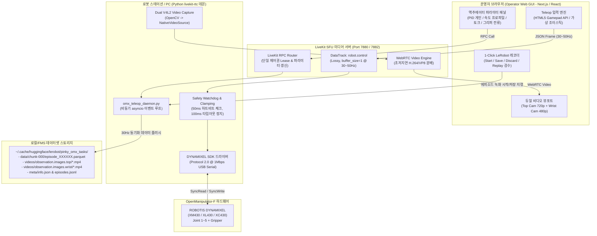

# [PT-23] LiveKit Teleop 기반 OMX 로봇팔 파라미터 제어 및 LeRobot 모방학습 데이터 수집 시스템 구현 계획서 (Implementation Plan)

> **문서 버전:** v1.0  
> **대상 이슈:** [Jira PT-23 (P0 긴급, 기한: 2026-10-24)](https://pinkyteam4.atlassian.net/browse/PT-23)  
> **상위 연계:** [FMS 관제 및 통합 대시보드(GUI) 메뉴 3.7](https://pinkyteam4.atlassian.net/wiki/spaces/PinkyTeam4/pages/6783015) &middot; [매니퓰레이터 작업 세부 계획서(김성아)](https://pinkyteam4.atlassian.net/wiki/spaces/PinkyTeam4/pages/3899403)  
> **대상 수신자:** 개발 및 구현을 수행할 **후속 AI 코딩 에이전트(Codex, Claude 등)** 및 프로젝트 코드 리뷰어  

---

## 1. 구현 개요 및 목표

### 1.1. 배경 및 긴급성
* Sprint 2 (10월 24일 배포)의 최우선 P0 과제인 **PT-23(OMX 모방학습·Teleop 개발 화면)**을 구현한다.
* 매니퓰레이터 파트(김성아 님)에서 **상차(S1/S2), 하차(Home), 회수품 분류(정상/파손) 태스크별 100~200 에피소드 데이터 수집**을 즉시 수행할 수 있도록, 웹 기반의 원격 조작(Teleoperation) 및 데이터셋 레코더 도구를 제공해야 한다.

### 1.2. 핵심 구현 목표
1. **LiveKit WebRTC 초저지연(`<100ms`) 텔레옵 연동**:
   - 상단 카메라(`camera_top`, 720p@30fps)와 손목 카메라(`camera_wrist`, 480p@30fps)의 저지연 듀얼 스트리밍.
   - WebRTC DataTrack(`robot.control`)을 통한 30~50Hz 무손실/무지연 조작 지령 전송.
2. **로봇팔(OpenManipulator-F) 전체 파라미터 실시간 제어**:
   - 5자유도 관절(Joint 1~5) 및 그리퍼의 위치, P/I/D 게인, 속도/가속도 프로파일, 토크 On/Off, 직접 교시(Lead-through Teaching) 모드 지원.
   - 그리퍼 전류 제한치(Current Limit) 튜닝으로 신발/비닐 포장 파손 방지 및 자동 파지 검출.
3. **LeRobot 표준 규격 1-Click 에피소드 레코더**:
   - 30Hz 관절 상태(`observation.state`), 조작 행동(`action`), 듀얼 비디오(`observation.images`) 동기화 로깅.
   - `[Record Start]`, `[Stop & Save]`, `[Discard & Retry]` 단축키 및 웹 화면 인라인 리플레이 검수.
   - HuggingFace LeRobot 학습 스크립트(`lerobot/scripts/train.py --policy.type=act`)에서 즉시 인제스트 가능한 Parquet/MP4 형식 저장.
4. **단일 제어권 및 안전성 보장 (`SR-19`, `SR-20`)**:
   - LiveKit RPC 기반 Single-Operator Lease(독점 제어권) 발급 및 세션 만료 관리.
   - 50ms 주기 하트비트 감시 Watchdog: 100ms 신호 단절 시 자동 감속 후 위치 유지(Safe Hold).

---

## 2. 시스템 아키텍처 및 데이터 흐름도



---

## 3. 새로 생성/수정할 파일 구조 및 역할

구현 에이전트는 아래 파일 트리에 따라 코드를 작성하고 배치해야 합니다:

```
robot_mini_project_pinky/
├── relay_station/
│   ├── configs/
│   │   ├── livekit.yaml                          # [신규] LiveKit 로컬 SFU 서버 설정 파일
│   │   └── omx_teleop_config.json                # [신규] 모터 ID, 포트, 관절 한계치, 카메라 디바이스 설정
│   ├── docker-compose.livekit.yml                # [신규] LiveKit Server 로컬 구동용 compose 파일
│   ├── omx/
│   │   ├── __init__.py
│   │   ├── dynamixel_hardware_interface.py       # [신규] DYNAMIXEL Protocol 2.0 SyncRead/Write 인터페이스 (Mock 모드 지원)
│   │   ├── omx_teleop_daemon.py                  # [신규] LiveKit RTC 연동 로봇 에이전트 데몬 및 Watchdog
│   │   └── lerobot_dataset_writer.py             # [신규] 30Hz 데이터 수집 및 LeRobot Parquet/MP4 익스포터
│   └── tests/
│       ├── test_dynamixel_interface.py           # [신규] 하드웨어 인터페이스 단위 테스트 (Mock 기반)
│       ├── test_omx_teleop_e2e.py                # [신규] LiveKit 연결 및 제어 루프 E2E 테스트
│       └── test_lerobot_dataset_export.py        # [신규] 수집 데이터셋의 LeRobot 규격 호환성 검증 테스트
├── gateway_web/ (또는 Next.js 대시보드)
│   ├── components/omx_teleop/
│   │   ├── DualCameraViewport.tsx (or .js)       # [신규] WebRTC 듀얼 비디오 렌더러 컴포넌트
│   │   ├── ActuatorParamPanel.tsx (or .js)       # [신규] 관절 슬라이더 및 PID/토크 튜닝 패널
│   │   ├── GamepadTeleopEngine.ts (or .js)       # [신규] HTML5 Gamepad API 입력 캡처 및 전송 엔진
│   │   └── LeRobotRecorderPanel.tsx (or .js)     # [신규] 1-Click 에피소드 레코더 및 리플레이 모달
│   └── static/css/omx_teleop.css                 # [신규] 텔레옵 스튜디오 스타일시트
└── docs/planning/
    └── PT23_OMX_LIVEKIT_TELEOP_LEROBOT_IMPLEMENTATION_PLAN.md # [본 문서]
```

---

## 4. 세부 컴포넌트별 기술 명세 및 코드 가이드

### 4.1. LiveKit 로컬 SFU 서버 설정 (`docker-compose.livekit.yml`)
로컬 관제 PC 또는 로봇 스테이션에서 즉시 구동할 수 있는 경량 컨테이너 정의:

```yaml
version: '3.8'

services:
  livekit:
    image: livekit/livekit-server:v1.7
    container_name: livekit-teleop-server
    restart: unless-stopped
    network_mode: host
    command: --config /etc/livekit.yaml
    volumes:
      - ./configs/livekit.yaml:/etc/livekit.yaml
```

**`configs/livekit.yaml`**:
```yaml
port: 7880
rtc:
  tcp_port: 7881
  port_range_start: 50000
  port_range_end: 50100
  use_external_ip: false
keys:
  API_KEY_DEV: "SECRET_KEY_DEV_PINKY4"
logging:
  level: info
```

---

### 4.2. DYNAMIXEL 하드웨어 인터페이스 (`dynamixel_hardware_interface.py`)

* **지원 모터**: ROBOTIS DYNAMIXEL XM430-W350 / XL430-W250 (ID 1: Base, ID 2: Shoulder, ID 3: Elbow, ID 4: Wrist Pitch, ID 5: Wrist Roll, ID 6: Gripper).
* **통신 프로토콜**: Protocol 2.0, Baudrate 1,000,000 bps, `/dev/ttyUSB0` (또는 `/dev/ttyACM0` OpenRB-150).
* **주요 제어 테이블 레지스터 주소 (X-Series)**:
  - `Torque Enable`: 주소 64 (1 byte)
  - `Position D Gain`: 주소 80 (2 byte), `Position I Gain`: 주소 82 (2 byte), `Position P Gain`: 주소 84 (2 byte)
  - `Profile Acceleration`: 주소 108 (4 byte), `Profile Velocity`: 주소 112 (4 byte)
  - `Goal Position`: 주소 116 (4 byte)
  - `Present Current`: 주소 126 (2 byte), `Present Velocity`: 주소 128 (4 byte), `Present Position`: 주소 132 (4 byte)
  - `Present Input Voltage`: 주소 144 (2 byte), `Present Temperature`: 주소 146 (1 byte)

**코드 핵심 구조**:
```python
class DynamixelHardwareInterface:
    def __init__(self, device_name="/dev/ttyUSB0", baudrate=1000000, mock=False):
        self.mock = mock
        self.joint_ids = [1, 2, 3, 4, 5, 6]  # 1~5: arm, 6: gripper
        self.limits = {
            1: (-3.1415, 3.1415),  # Base
            2: (-1.7453, 1.7453),  # Shoulder
            3: (-1.6580, 1.5707),  # Elbow
            4: (-1.8325, 1.8325),  # Wrist Pitch
            5: (-3.1415, 3.1415),  # Wrist Roll
            6: (0.0, 0.05)         # Gripper linear open (m)
        }
        if not self.mock:
            self._init_real_hardware(device_name, baudrate)
        else:
            self._init_mock_state()

    def sync_read_states(self) -> dict:
        """현재 관절 각도, 속도, 전류, 온도를 동기화 읽기 (30Hz)"""
        # return: {'positions': [...], 'velocities': [...], 'currents': [...], 'temps': [...]}
        pass

    def sync_write_goals(self, target_positions: list):
        """관절 목표치를 클램핑하여 모터에 동시 지령"""
        pass

    def set_pid_gains(self, joint_id: int, p: int, i: int, d: int):
        """특정 관절의 위치 제어 PID 게인 실시간 변경"""
        pass

    def set_torque_enable(self, enable: bool, joint_id: int = None):
        """특정 또는 전 관절 토크 On/Off (직접 교시 티칭 모드 토글)"""
        pass

    def set_gripper_current_limit(self, current_ma: int):
        """그리퍼 최대 파지 전류 상한 설정 (비닐/신발 보호용)"""
        pass
```

---

### 4.3. LiveKit 로봇 에이전트 데몬 (`omx_teleop_daemon.py`)

* **역할**: LiveKit SFU 방에 `robot_omx1`으로 접속하여 카메라 영상 스트림을 퍼블리시하고, 운영자의 `robot.control` DataTrack 및 RPC를 수신하여 로봇 하드웨어에 전달.
* **Watchdog 타이머 (`SR-20`)**: 50ms마다 마지막 명령 수신 시각을 확인하여 100ms 이상 지연 시 즉시 모터를 감속하고 `Position Hold` 모드로 전환.
* **단일 제어권 잠금 (`SR-19`)**: RPC `acquire_control_lease`로 유효 토큰 발행, 다른 조작자의 제어 명령은 원천 차단.

**DataTrack 패킷 규격 (`robot.control`)**:
```json
{
  "seq": 1042,
  "ts": 1729508400123,
  "lease_id": "lease_usr_01_a9f4",
  "target_joints": [0.0, 0.52, -0.41, 0.22, 0.0],
  "gripper_target": 0.035,
  "mode": "joint_jog"
}
```

**데몬 이벤트 루프 핵심 코드**:
```python
import asyncio
import json
import time
from livekit import rtc

class OmxTeleopDaemon:
    def __init__(self, hardware_if, room_url="ws://127.0.0.1:7880", token="..."):
        self.hw = hardware_if
        self.room = rtc.Room()
        self.active_lease_id = None
        self.lease_operator = None
        self.last_command_time = 0.0
        self.watchdog_timeout_sec = 0.1  # 100ms
        self.is_holding = False

    async def run(self):
        # 1. 룸 연결
        await self.room.connect(self.room_url, self.token)
        
        # 2. 듀얼 카메라 트랙 퍼블리시
        await self._publish_camera_tracks()
        
        # 3. DataTrack 수신 리스너 등록
        self.room.on("data_received", self._on_data_received)
        
        # 4. RPC 핸들러 등록
        self.room.register_rpc_method("acquire_lease", self._rpc_acquire_lease)
        self.room.register_rpc_method("release_lease", self._rpc_release_lease)
        self.room.register_rpc_method("set_params", self._rpc_set_params)
        
        # 5. 주기적 루프 실행 (하트비트 Watchdog & 텔레메트리 송신)
        asyncio.create_task(self._watchdog_loop())
        asyncio.create_task(self._telemetry_loop())

    def _on_data_received(self, data_packet: rtc.DataPacket):
        if data_packet.topic != "robot.control":
            return
        
        payload = json.loads(data_packet.data.decode("utf-8"))
        
        # 제어권(Lease) 및 유효시간(50ms) 검증
        if payload.get("lease_id") != self.active_lease_id:
            return
        
        now = time.time()
        pkt_time = payload.get("ts", 0) / 1000.0
        if (now - pkt_time) > 0.05:  # 50ms 초과 지연 패킷 폐기 (SR-20)
            return

        self.last_command_time = now
        self.is_holding = False
        
        # 모터 하드웨어 지령 적용
        self.hw.sync_write_goals(payload["target_joints"], payload.get("gripper_target"))

    async def _watchdog_loop(self):
        while True:
            await asyncio.sleep(0.02)  # 20ms 주기 감시
            if not self.is_holding and self.active_lease_id is not None:
                if (time.time() - self.last_command_time) > self.watchdog_timeout_sec:
                    # 신호 단절 -> 안전 멈춤 (Position Hold)
                    current_positions = self.hw.sync_read_states()["positions"]
                    self.hw.sync_write_goals(current_positions)
                    self.is_holding = True
                    print("[Safety Watchdog] Control signal lost. Holding position!")
```

---

### 4.4. 모방학습 데이터셋 레코더 (`lerobot_dataset_writer.py`)

* **데이터 구조**: HuggingFace LeRobot 표준 규격 준수.
* **수집 주기**: 30Hz 고정 주기 동기화.
* **디렉토리 레이아웃**:
  ```
  ~/.cache/huggingface/lerobot/pinky_omx_tasks/
  ├── meta/
  │   ├── info.json              # 데이터셋 메타데이터 (fps, 관절 이름, 비디오 해상도)
  │   └── episodes.jsonl         # 에피소드 인덱스 목록
  ├── data/
  │   └── chunk-000/
  │       └── episode_000000.parquet # 30Hz observation.state 및 action 데이터
  └── videos/
      ├── observation.images.top/chunk-000/episode_000000.mp4
      └── observation.images.wrist/chunk-000/episode_000000.mp4
  ```

**Parquet 스키마 정의 (`pyarrow`)**:
```python
import pyarrow as pa

STATE_SCHEMA = pa.schema([
    ("timestamp", pa.float64()),
    ("index", pa.int64()),
    ("observation.state", pa.list_(pa.float32(), 12)),  # [q1..q5, gripper, dq1..dq5, current_grip]
    ("action", pa.list_(pa.float32(), 6)),              # [target_q1..q5, target_grip]
    ("next.done", pa.bool_()),
    ("episode_index", pa.int64())
])
```

**에피소드 저장 및 폐기 API**:
```python
class LeRobotDatasetWriter:
    def __init__(self, root_dir="~/.cache/huggingface/lerobot/pinky_omx_tasks", fps=30):
        self.fps = fps
        self.buffer = []
        self.top_frames = []
        self.wrist_frames = []
        self.recording = False

    def start_episode(self, task_name: str, stop_error_offset: dict):
        self.buffer.clear()
        self.top_frames.clear()
        self.wrist_frames.clear()
        self.task_name = task_name
        self.stop_error = stop_error_offset  # {'dx_cm': 2.1, 'dy_cm': -1.4, 'dyaw_deg': 3.0}
        self.recording = True

    def record_step(self, obs_state, action, top_frame, wrist_frame):
        if not self.recording:
            return
        self.buffer.append({"state": obs_state, "action": action, "time": time.time()})
        self.top_frames.append(top_frame)
        self.wrist_frames.append(wrist_frame)

    def stop_and_save(self) -> int:
        """녹화 완료: Parquet 파일 및 MP4 비디오 저장 후 에피소드 ID 반환"""
        self.recording = False
        # 1. Parquet 인코딩
        # 2. OpenCV cv2.VideoWriter로 H.264 mp4 생성
        # 3. info.json & episodes.jsonl 갱신
        return episode_id

    def discard_episode(self):
        """실패한 시연 즉시 메모리에서 폐기 (불량 데이터 유입 원천 방지)"""
        self.buffer.clear()
        self.top_frames.clear()
        self.wrist_frames.clear()
        self.recording = False
```

---

### 4.5. 프론트엔드 UI 컴포넌트 (`Menu 3.7`)

* **HTML5 Gamepad API 연동 (`GamepadTeleopEngine.ts`)**:
  - `requestAnimationFrame` 또는 50Hz 인터벌로 `navigator.getGamepads()` 폴링.
  - Left Stick (X, Y): End-Effector 수평 이동 / Base & Shoulder 회전.
  - Right Stick (Y): Z축 높이 이동 / Elbow & Wrist Pitch 회전.
  - R2 Trigger (0.0 ~ 1.0): 그리퍼 닫힘 비례 제어.
  - Button L1 / R1: 에피소드 시작 / 완료 단축키.
  - Button B: 에피소드 폐기 및 리트라이.
* **단축키 안내 (키보드)**:
  - `Space`: 녹화 시작 (`Start`)
  - `Enter`: 녹화 완료 및 저장 (`Save`)
  - `Backspace`: 즉시 폐기 및 초기 자세 복귀 (`Discard`)
  - `P`: 소프트웨어 일시정지 (`Pause`)

---

## 5. 단계별 작업 절차 (Actionable Checklist for Agent)

후속 에이전트는 아래 체크리스트를 순차적으로 실행하며 커밋해야 합니다:

- [ ] **Step 1: 기본 패키지 및 가상환경 의존성 점검**
  - `pip install livekit livekit-api livekit-rtc dynamixel-sdk opencv-python pyarrow pytest`
  - Mock 모드 기반 테스트 환경 구축
- [ ] **Step 2: DYNAMIXEL 인터페이스 및 Mock 드라이버 구현**
  - 파일 생성: `relay_station/omx/dynamixel_hardware_interface.py`
  - 단위 테스트: `relay_station/tests/test_dynamixel_interface.py` 통과 (Mock 기반 6개 모터 SyncRead/Write 검증)
- [ ] **Step 3: LiveKit 로봇 데몬 및 Watchdog 구현**
  - 파일 생성: `relay_station/omx/omx_teleop_daemon.py`
  - 50ms 주기 Watchdog 안전 감속 동작 검증 (연결 차단 시뮬레이션 테스트)
- [ ] **Step 4: LeRobot 데이터셋 익스포터 구현**
  - 파일 생성: `relay_station/omx/lerobot_dataset_writer.py`
  - 30Hz 데이터 로깅 및 Parquet/MP4 파일 생성 단위 테스트 통과
- [ ] **Step 5: FMS 웹 GUI 3.7 컴포넌트 구현 및 연동**
  - 듀얼 카메라 뷰포트(Top/Wrist), 모터 파라미터 튜닝 슬라이더, 1-Click 레코더 UI 연동
- [ ] **Step 6: E2E 통합 테스트 및 5 에피소드 드라이런**
  - `python -m pytest relay_station/tests/test_omx_teleop_e2e.py`
  - Mock 환경에서 가상 조작 5회 수행 -> 데이터셋 디렉토리 생성 및 Parquet 유효성 검증

---

## 6. 검증 및 수용 기준 (Acceptance Criteria)

1. **지연시간(Latency)**:
   - WebRTC 비디오 지연시간: 로컬 네트워크 기준 **50ms 이내** (최악 조건 `< 100ms`).
   - 제어 패킷 왕복 시간(RTT): **30ms 이내**.
2. **안전성(Fail-safe)**:
   - 웹 브라우저 종료 또는 네트워크 단절 발생 시, 정확히 **100ms 이내**에 로봇 에이전트가 `Position Hold` 상태로 전환되어 추락/충돌 방지.
   - 단일 조작자 외 제3자의 조작 패킷은 무시되어 `SR-19` 단일 제어권 원칙 준수.
3. **모방학습 데이터 무결성**:
   - 30초 분량 에피소드 녹화 시, 정확히 약 **900스텝(30fps $\times$ 30s)의 Parquet 레코드와 MP4 비디오 프레임 수가 1:1로 일치**.
   - LeRobot CLI에서 `python lerobot/scripts/visualize_dataset.py --repo-id pinky_omx_tasks` 실행 시 오류 없이 영상 및 관절 궤적이 재생될 것.
