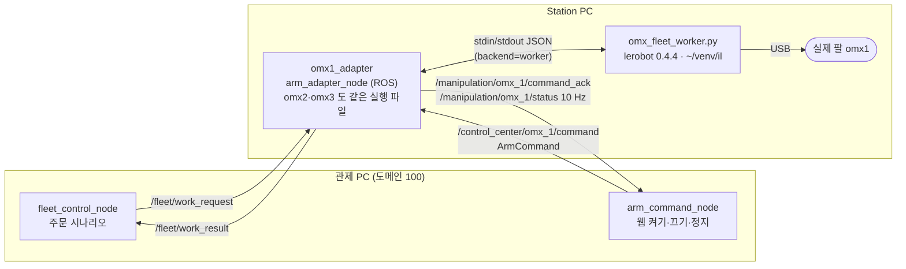
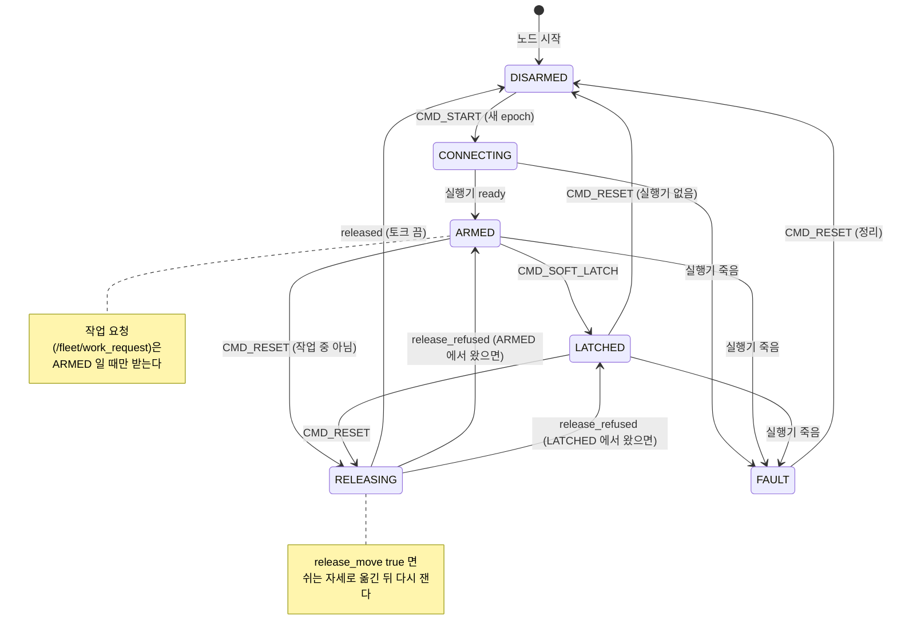
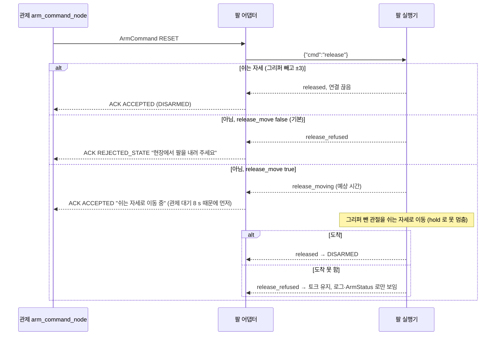

# cobot_manipulation PRD — Station PC 팔 노드

- 상태 (2026-11-15): 어댑터 노드, `worker` 백엔드, 관제 켜기·끄기 구현. 팔 1대(omx1) 실기 시험 전. 한 장 요약은 [`team_guide.md`](team_guide.md).
- 담당: 로봇팔 팀 (CODEOWNERS). 관제 계약 부분은 로봇 수행 관제 담당이 함께 본다.
- 공통 명세(`docs/fms_interfaces.md`)가 우선이다. 작업 요청은 아직 관제 코드의 String JSON(1절)을 쓰고, 켜기·끄기·상태는 정식 메시지(5절)를 쓴다.

## 0. 하는 일

Station PC 에서 팔(omx1~3)마다 어댑터 노드를 하나씩 띄워, 관제 작업 요청을 처리하고 실측 결과를 돌려준다.



## 1. 관제 계약 (정본: cobot_fleet_control 코드)

### 요청
`fleet_control_node.work()`·`scenario_runtime` 이 만든다. 이 노드는 `target` 이 자기 `arm_id` 인 것만 본다.

| 필드 | 뜻 |
|---|---|
| `request_id` | 요청 고유 번호. 같은 번호는 한 번만 실행 |
| `order_id`, `robot_id`, `stage` | 결과에 그대로 돌려준다 |
| `target` | 받을 팔 (`omx1` 등) |
| `action` | `pick`, `load`, `unload`, `warehouse_store`(반품 하차), `hold`, `release_hold` |
| `session_id`, `seq` | 관제 노드 실행마다 새 session. seq 는 target 별 증가 |
| `issued_at`, `ttl_sec` | [s] 관제 PC 시각, 유효 시간 (5 s) |
| `sku`, `quantity`, `attempt`, `route`, `timeout_sec` | 작업 정보 |

| stage | 팔 | action |
|---|---|---|
| `PICK` / `LOAD` | 상차 팔 (`route.pickup_arm`) | `pick` / `load` |
| `PICK_DROPOFF` / `UNLOAD` | 하차 팔 (`route.dropoff_arm`) | `pick` / `unload` 또는 `warehouse_store` |
| `SAFETY` | 경로의 팔 | `hold` / `release_hold` (관제는 결과를 기다리지 않음) |

### 결과
`scenario_runtime.receive()` 가 검사하고, 하나라도 틀리면 **조용히 버린다**.

```json
{"request_id": "...", "order_id": "...", "robot_id": "...", "stage": "...",
 "source": "omx1", "measured": true, "finished": true,
 "success": true, "detail": "(실패 이유, 선택)", "data": {"arm_safe": true}}
```

- `data.retry_safe=true` 가 없는 실패는 관제가 재시도하지 않고 주문을 보류한다.
- `retry_safe` 는 **팔을 움직이기 전 거절**에만 붙인다 (탐지 안 됨, 만료, 시계 차이, 정지 유지 중, 작업 중, 백엔드 없음, 꺼짐).
  작업 도중 `hold`·보드 끊김으로 끝나면 팔 자세를 모르므로 붙이지 않는다.

### 요청 판정 순서
1. `target` 이 다르거나 필수 필드가 없으면 무시. 이미 본 `request_id`(최근 `dedupe_size` 개)도 무시.
2. `session_id` 가 바뀌면 seq 기록을 비운다. seq 가 줄면 무시.
3. 만료(`now > issued_at + ttl_sec`)·미래 시각이면 거절 (retry_safe). 두 PC 시계는 chrony 등으로 맞춘다.
4. 모르는 action 은 거절 (retry_safe 없음). `hold` 는 2·3번에 걸려도 실행한다 (멈춤 거절이 더 위험, D4 추천안).

## 2. 팔 탐지

- 보드(OpenRB-150) 고유 시리얼이 `/dev/serial/by-id/usb-ROBOTIS_OpenRB-150_<시리얼>-if00` 로 보인다. 노드는 이름만 읽고 장치를 열지 않는다 (udev·`sudo` 불필요).
- `config/arm_registry.yaml` = 팔 자리 이름(관제 `scenario.yaml` 의 `pickup_arm`·`dropoff_arm`) ↔ 보드 시리얼.
- 등록된 시리얼이 정확히 1개 보일 때만 READY. 미등록·연결 안 됨·중복 등록·여러 장치는 UNKNOWN 이고 작업을 거절한다. `detect_period_sec` 마다 다시 보고, 작업 중 사라지면 실패로 끝낸다.
- 시리얼은 팔이 아니라 보드의 번호다. 보드와 팔에 같은 이름표를 붙인다. 새 팔: `ls -l /dev/serial/by-id` 로 읽어 빈 칸에 넣는다.

## 3. 백엔드

| 이름 | 동작 | 쓰는 곳 |
|---|---|---|
| `none` (기본) | 모든 작업을 거절 (retry_safe) | 실제 백엔드가 없을 때 |
| `fake` | `fake_duration_sec` 뒤 성공, `data.fake=true` | 격리 도메인 시험만. 실물 도메인 0·10·12·20·30·100 이면 시작 거부 |
| `worker` | 계속 켜 두는 팔 실행기에 stdin/stdout JSON 으로 일을 시킴 | 실제 팔. **팔이 움직인다** |

### 3-1. `worker` 백엔드와 팔 실행기 계약

lerobot 은 연결·해제 때 토크를 꺼서 팔이 떨어지고 물건을 놓친다. 그래서 `CMD_START` 에 실행기를 한 번 띄우고, 실행기는 토크를 유지한 채 일을 기다린다.
실행기 쪽 자세한 동작은 `tool/omx-dashboard` 브랜치 `omx_fleet/README.md` 가 정본이다.

- 실행: `worker_command`(셸 없이 공백으로 나눔), 환경변수 `ARM_ID`·`ROBOT_PORT`.
- stdin (한 줄 = JSON): `run`(id, action) · `hold` · `state` · `release` · `quit`. stdout 은 `@fleet ` 로 시작하는 줄만 기계용이고 나머지는 노드 로그로 옮긴다.

| 실행기 event | 어댑터 처리 |
|---|---|
| `ready` | ARMED. 그 전 요청은 거절 (retry_safe) |
| `started` | 없음 |
| `done` | **`success` 와 `arm_safe` 가 둘 다 true 일 때만 성공**. `data` 에 `arm_safe`·`end_reason`·`success_basis`·`pose_error`·`joints` |
| `rejected` | 움직이기 전 거절 → retry_safe 실패 |
| `fatal` / 프로세스 끝남 | FAULT, 이후 모든 작업 거절. 저절로 다시 띄우지 않는다 (정상 `released` 뒤 끝남은 제외) |
| `state` | `ArmStatus` 관절 갱신 (`state_poll_sec` 마다 요청) |
| `release_moving` | RESET 에 바로 ACCEPTED, 기한 연장 (5절 끄기 순서) |
| `released` / `release_refused` | DISARMED + ACCEPTED / 이전 상태 + REJECTED_STATE |

- `hold`·시간 초과(요청 `timeout_sec` 과 `worker_timeout_sec` 중 짧은 쪽): SIGINT 대신 `hold` 를 보내 **토크를 유지한 채 멈춘다**. 그 작업은 retry_safe 없는 실패, 멈춤이 끝날 때까지 새 작업은 '작업 중' 거절.
- 노드를 끄면 `quit` → 토크가 꺼져 **팔이 내려앉을 수 있다**. 평소에는 노드를 켜 두고 관제로 끈다.
- 연결할 때 lerobot `configure()` 가 토크를 잠깐 껐다 켠다. 켤 때 팔은 쉬는 자세에 둔다.

### 3-2. 팔 실행기 `omx_fleet`

팔 팀 `omx_chain.py` 의 함수를 그대로 쓴다. 팔별 설정은 `omx_fleet/fleet_arms.yaml` (git 제외, `fleet_arms.example.yaml` 을 복사).

| action | 모델 | 시간 |
|---|---|---|
| `pick` | `omx_shoebox_d/models/act_shoebox_d_5000step` | 90 s |
| `load` | `omx_move_in_success/models/act_move_in_5000step` | 90 s |

- 순서: 모델의 `init_pose.json` 으로 이동 → 정책 실행 → 안전 자세로 이동(그리퍼 제외) → 다시 재서 판정.
- `success`: `success.json` 의 YOLO 판단이 성공일 때만. **지금은 판단 모델이 없어 항상 false** → 관제는 주문을 보류한다 (가짜 성공을 보내지 않음).
- `arm_safe`: 그리퍼를 뺀 모든 관절 오차 3 단위(약 5°) 이하. `hold` 로 끝나면 false.
- **위험**: 안전 자세 이동은 보간이라 상자 안에서 걸릴 수 있다 / 자세 이동 중(수 초)에는 `hold` 가 이동 끝을 기다린다 / 보드 `6D96...` 캘리브레이션(`omx_follower.json`) 미확인.

## 4. 실행

```bash
colcon build --symlink-install --packages-up-to cobot_manipulation && source install/setup.bash
scripts/run_arm_adapter.sh --domain 101 --localhost --backend fake   # 혼자 시험 (팔 안 씀)
scripts/run_arm_adapter.sh                                           # 관제와 연결: 도메인 100, worker
/usr/bin/python3 scripts/arm_console.py                              # 관제 대신 명령 (어댑터와 같은 도메인·범위)
ros2 launch cobot_manipulation arm_station.launch.xml backend:=fake  # 팔 3대 (enable_omx1~3, registry_file)
```

- `run_arm_adapter.sh`: 도메인 10·12, 중복 노드, 단독 실행기, 보드, 실행기 파일을 확인하고 띄운다. 기본 경로가 다르면 `OMX_FLEET_DIR`·`OMX_VENV_PY`.
- `arm_console.py`: `start` `pick` `load` `hold` `unhold` `latch` `reset` `s` `saverest [경로]` `wait N` `q`. `saverest` 는 지금 관절을 쉬는 자세 파일(기본 `<omx_fleet>/rest_pose_omx1.json`)로 저장한다.
- `worker` 는 START 를 받으면 실제 팔이 움직인다. 사람이 팔 옆에 있을 때만 띄운다. 꺼짐(DISARMED) 동안은 연결·토크가 없어 켜 두어도 된다. 파라미터는 `config/arm_adapter.yaml`.

## 5. 관제 켜기·끄기 (`ArmCommand` → `CommandAck`·`ArmStatus`)

`cobot_interfaces` 의 기존 메시지만 쓴다. 토픽의 팔 이름은 명세대로 `omx_1` 이고 시나리오의 `omx1` 에서 만든다 (`interface_arm_id`).

| 토픽 | 타입 | 방향 | QoS |
|---|---|---|---|
| `/control_center/omx_1/command` | `ArmCommand` | 관제 → 팔 노드 | RELIABLE, VOLATILE, depth 10 |
| `/manipulation/omx_1/command_ack` | `CommandAck` | 팔 노드 → 관제 | RELIABLE, VOLATILE, depth 50 |
| `/manipulation/omx_1/status` | `ArmStatus` | 팔 노드 → 관제, 10 Hz | BEST_EFFORT, VOLATILE, depth 1 |

### 전원 상태 흐름



| 명령 | 되는 상태 | 하는 일 | ACK |
|---|---|---|---|
| `CMD_START` | DISARMED, 팔 탐지 READY, backend ≠ none | 실행기를 띄워 팔에 연결 (토크 켜짐) | 바로 |
| `CMD_RESET` | ARMED·LATCHED (작업 중 아님) | 실행기에 `release` (아래 끄기 순서) | 실행기 답 뒤 (`release_timeout_sec`) |
| `CMD_RESET` | FAULT, 또는 실행기 없는 LATCHED | 정리하고 DISARMED | 바로 |
| `CMD_SOFT_LATCH` | 아무 때나 | 작업을 멈추고 LATCHED (토크 유지) | 바로, `stop_executed=true` |
| `CMD_HOLD` / `CMD_RELEASE_HOLD` | 아무 때나 | `/fleet/work_request` 의 hold/release_hold 와 같다 | 바로 |

ARMED 가 아닐 때 작업 요청은 retry_safe 로 거절한다 (`팔 전원 DISARMED (관제 CMD_START 필요)` 등). `auto_start: true` 면 관제 없이 팔이 탐지되자마자 켠다 (기본 false).

#### 끄기 순서 (`CMD_RESET`)



- **기본은 팔을 옮기지 않는다** (`ArmCommand.msg`: 팔 모션은 FMS 가 시작하지 않는다). 안전 자세를 쉬는 자세와 같게 두면 작업 뒤 바로 끌 수 있다.
- `release_move: true` 는 실행기 `fleet_arms.yaml` 의 현장 설정이다. 충돌 검사가 없고 이동 중 hold 가 안 되므로(비상은 12 V 차단) `rest_pose` 를 실측한 뒤에만 켠다. 이동 시간이 길면 기한은 이동 시간 + `release_timeout_sec`.

### 헤더 판정 (`CommandHeader`, SR-20)

| 검사 | 거부 |
|---|---|
| `robot_id` 가 `omx_1` 이 아님 | `REJECTED_ROBOT_ID` |
| `ttl_ms` 0, 만료(`now > issued_at + ttl`), 미래(`issued_at > now + ttl`) | `REJECTED_TTL` |
| `CMD_START` 의 `epoch` 가 받아들인 epoch 이하 | `REJECTED_EPOCH` (START 는 새 epoch 에서만) |
| 그 밖 명령의 `epoch` 가 받아들인 epoch 와 다름 | `REJECTED_EPOCH` |
| `seq` 가 마지막 수락 seq 이하 | `REJECTED_SEQ` |
| 지금 상태에서 안 되는 명령 | `REJECTED_STATE` |

- 정지 계열(`CMD_HOLD`·`CMD_SOFT_LATCH`)은 **판정이 거부여도 정지**하고 `stop_executed=true` 를 보낸다.
- 보지 않는 것: `map_hash`, `sig`(D13 미정, **서명 검사 없음**), 시계 오프셋(`REJECTED_CLOCK_UNSYNCED`).
- epoch·seq 는 노드 메모리에만 있다. 노드를 다시 켜면 처음부터 받는다 (`robot_boot_id` 가 바뀐다).

### `ArmStatus` 채우는 법

| 필드 | 값 |
|---|---|
| `header.stamp` | 관절을 마지막으로 잰 시각 (작업 중에는 오래된다 → 화면은 STALE) |
| `joint_names`·`joint_positions`·`gripper_position` | 실행기 `joints` (lerobot -100..100, 그리퍼 0..100). 모르면 빈 값·NaN |
| `joint_unit` | `""` (lerobot 단위가 명세 열거에 없음) |
| `torque_enabled` | 실행기가 떠 있고 CONNECTING·ARMED·LATCHED·RELEASING |
| `retract_safe` / `retract_safe_measured` | 마지막 작업의 `arm_safe` / 실제로 쟀는가. 새 작업·새 연결이면 둘 다 false |
| `hold_active`·`hold_reason` | HOLD 또는 LATCHED (`HOLD`·`SOFT_LATCH`) |
| `work_step` | ARMED 대기 중이면 `IDLE`, 그 밖은 `""` |
| `epoch_accepted`·`last_seq_accepted` | 헤더 판정 기록 |
| `power_present` / `present_current_ma` | false (측정 수단 없음, D6) / 빈 값 |

- 명세의 `retract_safe` 는 "Z ≥ 280 mm" 이지만 여기서는 관절 오차로 판정한다 (정본 고정값 아님, CLAUDE.md).
- 전원 상태 칸은 없다 (`torque_enabled`·ACK 사유로만 앎). `ArmMode` 는 Station 요약 노드의 몫이다.

## 6. 남은 일과 팀 결정

남은 일:
- omx1 실기 시험: 보드 `6D96...` 가 omx1 자리 팔인지, 캘리브레이션.
- 쉬는 자세(`rest_pose`) 실측: 지금은 shoebox_d 시작 자세. 팔을 쉬는 자세에 두고 `saverest`.
- 성공 판단 YOLO 모델 (`success.json` 의 `model`).
- 관제 켜기·끄기 버튼(`feature/control-center`, 2026-11-15)의 submaster 병합·실물 확인. 관제 PC cyclonedds Peers 에 Station PC IP.
- omx2·omx3 실행기 설정·보드 시리얼. 관제 `scenario.yaml` 에 omx3 경로 없음 (역할 미정).
- Station PC 부팅 때 노드 자동 시작 (D18 뒤).

팀이 정할 것:
1. 팔 이름: 명세 `omx_1` vs 시나리오 `omx1` (지금은 `interface_arm_id` 로 이어 붙임).
2. `retract_safe` 기준: Z ≥ 280 mm vs 관절 오차 3 단위.
3. `ArmStatus` 에 전원 상태 칸을 넣을지.
4. `ArmCommand` 서명 키 (D13), 시계 오프셋 검사.
5. 끄기 때 팔 이동을 팀 기본으로 할지 (= `ArmCommand.msg` 규칙 변경). 지금은 기본 꺼짐, 현장 설정 `release_move` 로만.
