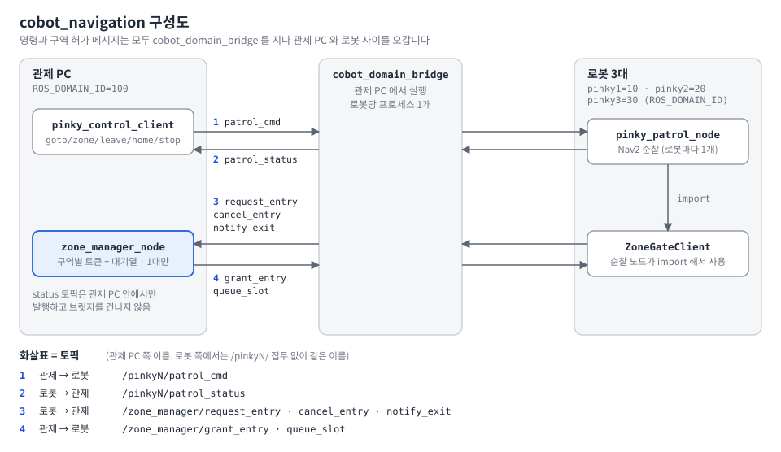
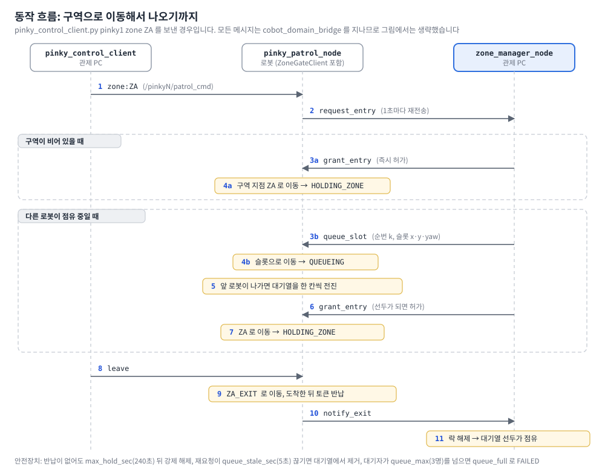

# cobot_navigation

Pinky 로봇 3대의 **주행·순찰**과 **위험구역 교통 관제**를 담당하는 폴더입니다.
이 폴더 자체는 colcon 패키지가 아니라 아래 하위 패키지·도구를 묶는 자리입니다.
이 문서는 **전체가 어떻게 이어지는지**와 **켜는 순서**만 정리하고, 세부 설명은 각 폴더의 README를 봅니다.

환경: Ubuntu 24.04 / ROS 2 Jazzy / Python 3.12

## 목차
1. 요약
2. 구성도
3. 폴더 구성
4. 동작 흐름
5. 토픽 맵
6. 빌드
7. 실행 순서
8. 순찰 명령
9. 수정 위치 안내
10. 테스트
11. 알려진 제약

## 요약

- 관제 PC에서 명령을 보내면 로봇이 Nav2로 이동합니다.
- 위험구역(`A`, `B`, `C`)에는 구역마다 **한 번에 한 대만** 들어갑니다. 나머지는 대기열 슬롯에서 기다립니다.
- 관제 PC와 로봇은 ROS 도메인이 달라서 `cobot_domain_bridge` 가 토픽을 중계합니다.

이 폴더를 관통하는 핵심은 세 가지입니다.

| 핵심 | 내용 | 담당 폴더 |
|---|---|---|
| 1. 도메인 분리 | 관제 PC는 `ROS_DOMAIN_ID=100`, pinky1/2/3은 각각 10/20/30. 브릿지가 필요한 토픽만 건네고, 관제 쪽 이름에는 `/pinkyN/` 을 붙인다 | `cobot_domain_bridge` |
| 2. 명령과 상태 | 관제 PC가 `/pinkyN/patrol_cmd` 로 명령을 보내고, 로봇이 `/pinkyN/patrol_status` 로 상태(JSON)를 돌려준다 | `cobot_pinky_patrol_cmd`, `cobot_pinky_patrol` |
| 3. 구역 토큰과 대기열 | 구역마다 토큰 1개와 FIFO 대기열을 관제 PC의 매니저가 관리한다. 로봇은 허가(토큰)를 받은 뒤에만 구역에 들어간다 | `cobot_zone_traffic_control` |

## 구성도



| 화살표 | 방향 | 토픽 (관제 PC 쪽 이름) |
|---|---|---|
| 1 | 관제 → 로봇 | `/pinkyN/patrol_cmd` |
| 2 | 로봇 → 관제 | `/pinkyN/patrol_status` |
| 3 | 로봇 → 관제 | `/zone_manager/request_entry`, `/zone_manager/cancel_entry`, `/zone_manager/notify_exit` |
| 4 | 관제 → 로봇 | `/zone_manager/grant_entry`, `/zone_manager/queue_slot` |
| - | 관제 PC 안에서만 | `/zone_manager/status` (구역 점유 상태, **브릿지를 건너지 않음**) |

`ZoneGateClient` 는 `cobot_zone_traffic_control` 의 클래스를 순찰 노드가 import 해서 쓰는 것이라, 로봇에도 그 패키지를 함께 설치합니다.

## 폴더 구성

| 폴더 | 종류 | 실행 위치 | 역할 | 상세 |
|---|---|---|---|---|
| `cobot_domain_bridge` | ROS 2 패키지 | 관제 PC | 관제 PC(100)와 로봇(10/20/30) 사이 토픽 중계 | [README](cobot_domain_bridge/README.md) |
| `cobot_zone_traffic_control` | ROS 2 패키지 | 관제 PC(매니저) / 로봇(클라이언트 import) | 위험구역에 한 대만 들어가도록 허가·대기열 슬롯 관리 | [README](cobot_zone_traffic_control/README.md) |
| `cobot_pinky_patrol` | ROS 2 패키지 | 각 로봇 | Nav2 순찰 노드 (`pinky_patrol_node_pinky1/2/3`) | [README](cobot_pinky_patrol/README.md) |
| `cobot_pinky_patrol_cmd` | 스크립트 | 관제 PC | 터미널에서 순찰 명령 전송·상태 모니터 | [README](cobot_pinky_patrol_cmd/README.md) |
| `map_view_pc` | 웹 뷰어 | 아무 PC | 지도 위에서 map 좌표 확인 (현재 지도 v9) | [README](map_view_pc/README.md) |
| `ros2_network_test` | 진단 도구 | 관제 PC | ROS 2 네트워크 진단·이상 이력 대시보드 | [README](ros2_network_test/README.md) |
| `docs/` | 자료 | - | 이전 지도 v6(`cobot_map/`), Nav2·SLAM 파라미터(`cobot_slam_nav_param/`) | [param_changes.md](docs/cobot_slam_nav_param/param_changes.md) |

## 동작 흐름: 구역으로 이동해서 나오기까지

`pinky_control_client.py pinky1 zone ZA` 를 보낸 경우입니다. 모든 메시지는 브릿지를 지나므로 그림에서는 브릿지를 생략했습니다.



- **3a / 4a (구역이 비어 있음)**: 매니저가 바로 허가하고, 로봇은 구역 지점으로 직행해 도착 후에도 토큰을 쥐고 있습니다(`HOLDING_ZONE`).
- **3b / 4b (다른 로봇이 점유 중)**: 매니저가 대기 순번 `k` 의 슬롯 좌표를 줍니다. 슬롯은 `앵커 + k × 간격 × 후방벡터` 이고, 로봇은 그 자리에서 `QUEUEING` 으로 기다립니다. 대기자가 `queue_max`(3명)를 넘으면 `queue_full` 로 `FAILED` 입니다.
- **8 ~ 10 (나오기)**: `leave` 는 구역 `EXIT` 에 **도착한 뒤** 토큰을 반납합니다. 반납되면 대기열 선두가 점유자가 됩니다.
- **안전장치**: 점유자가 반납하지 못해도 매니저가 `max_hold_sec`(240초) 뒤 강제 해제하고, 재요청이 `queue_stale_sec`(5초) 끊긴 대기자는 대기열에서 뺍니다. 마지막 명령 뒤 `idle_return_sec`(120초) 동안 새 명령이 없으면 로봇이 스스로 홈으로 돌아갑니다.
- 상태 JSON 의 `state`: `IDLE` `STARTING` `MOVING` `QUEUEING` `ARRIVED` `HOLDING_ZONE` `LEAVING_ZONE` `RETREATING` `RETURNING` `IDLE_WAIT` `DONE` `STOPPED` `FAILED` `RETRY` (`RETREATING` 은 구역 `EXIT` 로 후퇴해 토큰을 반납하러 가는 중)

## 토픽 맵

브릿지가 건네는 토픽입니다. 로봇 쪽은 이름 그대로, 관제 PC 쪽은 `/pinkyN/` 을 붙입니다(`/zone_manager/*` 는 그대로).

| 방향 | 토픽 |
|---|---|
| 관제 → 로봇 | `/pinkyN/patrol_cmd`, `/pinkyN/cmd_vel`, `/pinkyN/initialpose`, `/pinkyN/goal_pose` |
| 로봇 → 관제 | `/pinkyN/patrol_status`, `/pinkyN/scan`, `/pinkyN/odom`, `/pinkyN/tf`, `/pinkyN/tf_static`, `/pinkyN/amcl_pose`, `/pinkyN/battery_state`, `/pinkyN/battery/percent`, `/pinkyN/battery/voltage` |
| 구역 (로봇 → 관제) | `/zone_manager/request_entry`, `/zone_manager/notify_exit`, `/zone_manager/cancel_entry` |
| 구역 (관제 → 로봇) | `/zone_manager/grant_entry`, `/zone_manager/queue_slot` |
| pinky1 만 추가 | `/pinky1/lane/center_offset`, `/pinky1/lane/detected`, `/pinky1/crossline/detected` |

`/pinkyN/amcl_pose` 는 순찰 도착 판정에 쓰이므로 브릿지를 띄운 뒤 가장 먼저 확인합니다.

## 빌드

각 장비에서 워크스페이스 최상위(`src/` 가 있는 곳)에서 실행합니다.

```bash
source /opt/ros/jazzy/setup.bash

# 관제 PC
colcon build --symlink-install --packages-select cobot_zone_traffic_control cobot_domain_bridge

# 각 로봇 (patrol 노드가 zone_gate_client 를 import 하므로 둘 다 필요)
colcon build --packages-select cobot_zone_traffic_control cobot_pinky_patrol

source install/setup.bash
```

## 실행 순서

모든 터미널에서 `source /opt/ros/jazzy/setup.bash && source install/setup.bash` 를 먼저 합니다.
순서를 지켜 위에서부터 켭니다.

| 단계 | 장비 | 실행 | 도메인 |
|---|---|---|---|
| 1 | 각 로봇 | Nav2 bringup (로봇에 설치된 Nav2·`pinky_interfaces`·`pinky_led` 사용, 이 저장소에는 없음) | 10 / 20 / 30 |
| 2 | 관제 PC | 도메인 브릿지 | 100 |
| 3 | 관제 PC | zone_manager (**1대만**) | 100 |
| 4 | 각 로봇 | 순찰 노드 | 10 / 20 / 30 |
| 5 | 관제 PC | 순찰 명령 | 100 |

```bash
# 2. 관제 PC: 도메인 브릿지
export ROS_DOMAIN_ID=100
ros2 launch cobot_domain_bridge bridges.launch.xml                  # pinky1~3 모두
ros2 launch cobot_domain_bridge bridges.launch.xml pinky2:=false    # pinky2 제외
# 확인: ROS_DOMAIN_ID=100 ros2 topic echo /pinky1/amcl_pose --once

# 3. 관제 PC: zone_manager (새 터미널)
export ROS_DOMAIN_ID=100
ros2 launch cobot_zone_traffic_control zone_manager.launch.xml

# 4. 각 로봇: 순찰 노드 (좌표를 config/pinkyN.yaml 에서 읽으므로 launch 로 실행)
export ROS_DOMAIN_ID=10   # pinky1 (pinky2 = 20, pinky3 = 30)
ros2 launch cobot_pinky_patrol pinky1_patrol.launch.xml     # pinky2_patrol / pinky3_patrol
```

Nav2 파라미터는 [`docs/cobot_slam_nav_param/`](docs/cobot_slam_nav_param/param_changes.md) 에 정리되어 있습니다.
YAML 없이 `ros2 run` 만 하면 필수 지점이 비어 순찰 노드가 시작을 거부합니다. `ros2 run` 을 쓰려면 `--ros-args --params-file <config/pinkyN.yaml>` 를 붙입니다.

## 순찰 명령

**명령을 보내면 로봇이 실제로 움직이므로** 주변을 확인한 뒤 보냅니다. 워크스페이스 최상위에서 `ROS_DOMAIN_ID=100` 으로 실행합니다.

```bash
CLIENT=src/cobot_navigation/cobot_pinky_patrol_cmd/pinky_control_client.py
python3 $CLIENT pinky1 monitor          # 상태 출력 (별도 터미널, Ctrl+C 종료)
python3 $CLIENT pinky1 goto P1 P2       # 구역 밖 지점 이동 (홈으로 가지 않고 대기)
python3 $CLIENT pinky1 zone ZA          # 구역 지점: 토큰 받고 이동, 토큰 유지
python3 $CLIENT pinky1 leave            # 구역 EXIT 로 나가 토큰 반납
python3 $CLIENT pinky1 home             # 초기 위치(I1)로 복귀 (구역 안이면 토큰 반납 후)
python3 $CLIENT pinky1 stop             # 중지 (구역 안이면 EXIT 로 나와 반납)
python3 $CLIENT pinky1 emergency_stop   # 그 자리 정지, 토큰 유지
ros2 topic echo /zone_manager/status    # <구역>:free | <구역>:occupied_by:<robot_id>
```

| 명령 | 동작 |
|---|---|
| `goto <P>...` | 구역 밖 일반 지점(`P1`~`P10`)과 자기 홈(`I<n>`)만 순서대로 이동. 구역 지점을 주면 `FAILED: use zone` |
| `zone <ZA\|ZB\|ZC>` | 구역 지점 1개로 이동. 토큰을 받은 **뒤에만** 출발하고 도착 후 유지(`HOLDING_ZONE`) |
| `leave` | 보유 중인 구역의 `EXIT` 로 이동, **도착한 뒤** 토큰 반납 |
| `home` | 홈(`I1`/`I2`/`I3`)으로 복귀 |
| `stop` / `emergency_stop` | 중지 / 그 자리 정지 + 토큰 유지(`max_hold_sec` 뒤 매니저가 강제 해제) |
| `start` | v1.1.0 에서 비활성 (`FAILED: start disabled`) |

작업 중 온 명령은 무시됩니다. 로봇 없이 구역을 점유 상태로 만들어 대기열을 시험하는 방법은
[`cobot_zone_traffic_control/README.md`](cobot_zone_traffic_control/README.md#구역-수동-점유--해제-시험용) 를 참고합니다.

## 수정 위치 안내

| 바꾸려는 것 | 파일 | 주의 |
|---|---|---|
| 지점 좌표, 홈, 구역 소속, 유휴 복귀 시간 | `cobot_pinky_patrol/config/pinky{1,2,3}.yaml` | 좌표는 소수점으로(`0.0`). 맵이 바뀌면 이 YAML 만 고친다 |
| 구역 이름, 대기 앵커·방향·간격, 대기 상한, 타임아웃 | `cobot_zone_traffic_control/config/zone_params.yaml` | `robot_ids`, `zone_names` 는 순찰 YAML 과 같아야 한다. 앵커는 여기가 **유일한 출처** |
| 브릿지 토픽 추가·수정 | `cobot_domain_bridge/config/pinky_bridge_pinky{1,2,3}.yaml` | 세 파일을 **같이** 고친다 |
| 순찰 흐름 | `cobot_pinky_patrol/cobot_pinky_patrol/pinky_patrol_node_pinky{1,2,3}.py` | 세 파일이 거의 같으므로 같이 맞춘다 |
| Nav2·SLAM 파라미터 | `docs/cobot_slam_nav_param/` | 변경 이력은 `param_changes.md` |
| 지도 | `map_view_pc/maps/` (v9), `docs/cobot_map/` (이전 v6) | 뷰어에서 yaml 과 pgm 을 함께 불러온다 |

위험구역의 소속은 A = `ZA`, B = `ZB`, C = `ZC` 이고 홈과 `P1`~`P10` 은 구역 밖입니다.

## 보조 도구

```bash
# 맵 뷰어: 서버 없이 브라우저로 열고, 화면에서 map_view_pc/maps/cobot_map_v9.yaml 과 .pgm 을 함께 불러온다
xdg-open src/cobot_navigation/map_view_pc/pinky_map_viewer.html

# 네트워크 진단
cd src/cobot_navigation/ros2_network_test
./ros2_net_diag.sh <로봇 IP>     # 터미널 1: 진단 수집 (ROS 환경 source 후)
python3 net_monitor.py           # 터미널 2: 대시보드 → http://localhost:8088/
```

## 테스트

```bash
# 대기열 통합 테스트 (격리 도메인에서만 실행, 아니면 skip)
ROS_DOMAIN_ID=77 ROS_LOCALHOST_ONLY=1 python3 -m pytest src/cobot_navigation/cobot_pinky_patrol/test/test_patrol_queue.py -q

# zone 단위 테스트
cd src/cobot_navigation/cobot_zone_traffic_control && python3 -m pytest test/
```

- 개발·시뮬레이션은 `ROS_DOMAIN_ID=100`, 격리 시험은 77을 씁니다. 로봇 도메인 10/20/30 에서는 시험용 노드를 띄우지 않습니다.

## 알려진 제약

실측이 남았거나 구조상 확인이 필요한 항목입니다.

- **지점 좌표 미실측**: `P1`~`P10` 은 모두 `(0, 0, 0)` 자리표시자라 `goto` 하면 원점으로 갑니다. pinky1~3 의 구역 지점·일반 지점 좌표도 같은 값이며 실측 확인이 남아 있으니, 확인 전에는 구역 지점으로 이동하지 마세요.
- **대기 위치 실측**: 줄이 늘어나는 `-y` 쪽에 장애물이 없는지 확인해야 합니다. 구역 A·B 는 대기 위치가 같아서 두 구역에 대기자가 동시에 생기면 같은 슬롯으로 가 충돌할 수 있습니다. A·B 슬롯 2 는 홈 `I1` 과 0.1 m, C 슬롯 1 은 `ZC_EXIT` 와 0.4 m 입니다.
- **`start` 순회 비활성**: v1.1.0 부터 `start` 는 받으면 `FAILED` 로 응답합니다(순회 코드는 노드 파일에 주석으로 보관).
- **함께 재배포**: 메시지 맨 앞에 구역 이름이 붙으므로 **관제 PC 매니저 → 로봇 3대 순서로 함께** 재배포해야 하고 구형 노드와 섞어 쓸 수 없습니다. 같은 구역을 쓰는 로봇은 모두 같은 대기열 방식이어야 하며, 이전 세대(`v2-final` 태그)와 섞으면 두 대가 동시에 구역에 들어갈 수 있습니다.
- **패키지 간 import**: 순찰 노드가 `cobot_zone_traffic_control.zone_gate_client` 를 직접 import 하는데, `cobot_pinky_patrol/package.xml` 에는 의존성이 선언되어 있지 않습니다. CLAUDE.md 3-6(기능 패키지끼리 import 하지 않고 토픽으로만 통신)과도 다르므로, 공용 패키지로 옮길지 팀 결정이 필요합니다.
- **ROS 도메인 번호**: 이 폴더는 관제 PC 100, 로봇 10/20/30 을 씁니다. 팀 공통 결정 D2([`docs/fms_decisions.md`](../../docs/fms_decisions.md))는 실물 10·12 제안이 `proposed` 상태라 확정되면 맞춰야 합니다.
- **Nav2 파라미터 문서**: `param_changes.md` 는 정적 비교 결과이며 실제 실행으로 검증하지 않았습니다.
- **브릿지 설정 중복**: 토픽을 추가·수정할 때 `pinky_bridge_pinky{1,2,3}.yaml` 세 파일을 같이 고쳐야 합니다.
