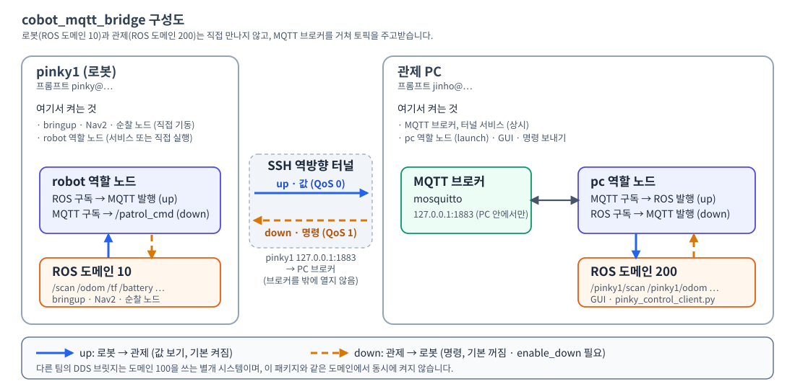

# cobot_mqtt_bridge

로봇(pinky1~3, ROS 도메인 10)과 관제 PC(ROS 도메인 200) 사이의 ROS 2 토픽을 MQTT로 중계하는 ROS 2 Python 패키지입니다.



## 주요 기능
- **로봇 → 관제(up):** 로봇의 `/scan`, `/odom`, `/tf`, `/amcl_pose`, 배터리 등 값을 MQTT로 보내 관제 PC의 도메인 200에 `/pinky1/...` 이름으로 다시 발행합니다. 기본으로 켜져 있습니다.
- **관제 → 로봇(down):** `patrol_cmd` 같은 명령을 MQTT로 보내 로봇 도메인 10에 발행합니다. **로봇이 움직일 수 있어 기본은 꺼져 있고** `enable_down:=true`를 줘야 켜집니다.
- **안전장치:** 실제 도메인(10, 200)에 발행하려면 `confirm_real_domain`을 명시해야 합니다. `cmd_vel`은 속도 상한, 오래된 메시지 폐기, 워치독을 거칩니다. 관제 역할은 도메인 10에 발행하지 않습니다. 부하(load)가 `load_abort`(3.0)를 넘으면 로봇 쪽 중계를 스스로 멈춥니다.
- **연결 보안:** MQTT 브로커는 관제 PC의 `127.0.0.1:1883`에만 열고, 로봇은 SSH 역방향 터널로 접속합니다.
- **로봇별 토픽 목록:** `config/mqtt_topics_pinky1~3.yaml` 로 로봇마다 중계할 토픽을 따로 정합니다.
- 기존 `cobot_domain_bridge`(DDS 방식)와 별개이며, **같은 도메인에서 동시에 켜지 않습니다.**

## 설치 방법
관제 PC(Ubuntu 24.04, ROS 2 Jazzy)에서 실행합니다. `sudo`가 들어간 줄은 직접 입력하세요.

```bash
# 1) 브로커와 MQTT 클라이언트
sudo apt update && sudo apt install -y mosquitto mosquitto-clients python3-paho-mqtt
systemctl is-active mosquitto && ss -ltn | grep 1883     # active, 127.0.0.1:1883 만 보이면 정상

# 2) 빌드 (저장소 루트가 아니라 src/cobot_navigation 에서. 코드를 고치면 매번 다시 빌드)
cd ~/dev_ws/kernel-robot-repo-4/src/cobot_navigation
source /opt/ros/jazzy/setup.bash
colcon build --packages-select cobot_mqtt_bridge
source install/setup.bash
```

로봇(pinky1)에는 코드와 토픽 YAML만 복사합니다. 빌드는 하지 않습니다. 코드나 YAML을 고치면 다시 실행합니다.
```bash
cd ~/dev_ws/kernel-robot-repo-4/src/cobot_navigation
tar --exclude=__pycache__ -cf - cobot_mqtt_bridge/cobot_mqtt_bridge cobot_mqtt_bridge/config \
  | ssh pinky@192.168.45.21 'mkdir -p ~/mqtt_bridge && tar -xf - -C ~/mqtt_bridge'
ssh pinky@192.168.45.21 'python3 -c "import paho.mqtt, yaml; print(\"ok\")"'     # ok 가 나와야 함
```
- paho-mqtt는 apt 기본 1.6.1로 시험했습니다. `pip`로 설치하지 않습니다.
- pinky1에 SSH 키가 없으면 `ssh-copy-id pinky@192.168.45.21`로 먼저 등록합니다.
- [TODO] pinky1 IP(`192.168.45.21`)가 바뀌면 `config/mqtt_bridge_tunnel.service`의 `ExecStart`를 고칩니다.

## 실행 방법
명령을 입력하는 곳을 표시했습니다. **[PC]**는 관제 PC 터미널, **[pinky1]**은 `ssh pinky@192.168.45.21`로 접속한 뒤 입력합니다.

### 1. 단위 시험 (위험 없음) — [PC]
```bash
cd ~/dev_ws/kernel-robot-repo-4/src/cobot_navigation/cobot_mqtt_bridge
source /opt/ros/jazzy/setup.bash
python3 -m pytest test -q          # 54 passed
```

### 2. 가짜 모드 (로봇 없이, 이 PC 안에서만) — [PC] 터미널 4개
실물 터널·서비스가 꺼져 있을 때만 하세요. 터미널마다 먼저 입력합니다.
```bash
source /opt/ros/jazzy/setup.bash; source ~/dev_ws/kernel-robot-repo-4/src/cobot_navigation/install/setup.bash
export CYCLONEDDS_URI='<CycloneDDS><Domain><General><Interfaces><NetworkInterface name="lo"/></Interfaces><AllowMulticast>false</AllowMulticast></General><Discovery><Peers><Peer Address="127.0.0.1"/></Peers></Discovery></Domain></CycloneDDS>'
export P=~/dev_ws/kernel-robot-repo-4/src/cobot_navigation/cobot_mqtt_bridge/config/mqtt_bridge.yaml
```
`export`는 입력한 터미널에서만 유효하므로 **터미널마다 입력**해야 합니다.
```bash
ROS_DOMAIN_ID=102 ros2 run cobot_mqtt_bridge mqtt_bridge_node --ros-args --params-file $P -p robot:=pinky1 -p side:=pc -p duration_sec:=60.0      # 터미널 1: 관제 역할
ROS_DOMAIN_ID=101 ros2 run cobot_mqtt_bridge mqtt_bridge_node --ros-args --params-file $P -p robot:=pinky1 -p side:=robot -p duration_sec:=60.0   # 터미널 2: 로봇 역할
ROS_DOMAIN_ID=101 ros2 topic pub -r 5 /battery/percent std_msgs/msg/Float32 "{data: 88.0}"                                                      # 터미널 3: 가짜 값
ROS_DOMAIN_ID=102 ros2 topic echo /pinky1/battery/percent                                                                                        # 터미널 4: 통과 시 data: 88.0
```

### 3. 실물 읽기 (로봇은 움직이지 않음)
전제: pinky1에서 bringup이 켜져 있어야 합니다.
```bash
sudo systemctl start mqtt_bridge_tunnel                                          # [PC] 터널 (PC 에만 있는 서비스)
ssh -t pinky@192.168.45.21 'sudo systemctl start mqtt_bridge_robot'              # [PC] 로봇 쪽 중계 (읽기 전용 서비스)
mosquitto_sub -h 127.0.0.1 -t 'mqtt_bridge/pinky1/status/#' -v -W 5              # [PC] robot 이 online 이면 정상
```
서비스 파일 설치는 `sudo`가 필요합니다. 파일은 `config/mqtt_bridge_tunnel.service`(PC), `config/mqtt_bridge_robot.service`(pinky1)입니다.
```bash
# [PC] 관제 쪽 켜기 (터미널 2개, 둘 다 위 2번의 source·export 입력 + export ROS_DOMAIN_ID=102)
ros2 launch cobot_mqtt_bridge mqtt_bridge.launch.xml pinky2:=false pinky3:=false     # 터미널 1
ros2 daemon stop; ros2 topic list --no-daemon; ros2 topic hz /pinky1/scan             # 터미널 2: 약 10 Hz
```
- 실제 관제 도메인 200에 내보내려면 launch에 `confirm_real_domain:=200`을 붙입니다.
- **launch는 PC에서만 실행합니다.** 로봇(도메인 10)에서 실행하면 안전 규칙으로 거부됩니다.

### 4. 명령 `goto` (**로봇이 움직임** — 전원을 끌 수 있는 사람이 옆에서 지켜볼 때만)
로봇 서비스는 끄고(`sudo systemctl stop mqtt_bridge_robot`), 양쪽 노드를 `enable_down`으로 직접 켭니다. 아래 보호 값은 시험용 제안이며 팀 합의 전입니다. [TODO]
```bash
# [PC] 한 번만: 중계할 명령을 patrol_cmd 하나로 줄이고 보호 값을 둔 파일을 만들어 pinky1 로 복사
cat > ~/mqtt_down_test.yaml <<'YAML'
"/**":
  ros__parameters:
    exclude_patterns: ["*/lane/*", "*/crossline/*", "/cmd_vel", "/goal_pose", "/initialpose", "/zone_manager/*"]
    watchdog_ms: 500.0
    max_linear: 0.15
    max_angular: 0.4
YAML
scp ~/mqtt_down_test.yaml pinky@192.168.45.21:~/
```
```bash
# 터미널 A — [pinky1]: 로봇 쪽 (켜 둠)
source /opt/ros/jazzy/setup.bash; source ~/cobot_navigation/install/setup.bash
export ROS_DOMAIN_ID=10 RMW_IMPLEMENTATION=rmw_cyclonedds_cpp CYCLONEDDS_URI=file:///home/pinky/.ros/cyclonedds_robot.xml
ros2 run cobot_mqtt_bridge mqtt_bridge_node --ros-args \
  --params-file ~/cobot_navigation/install/cobot_mqtt_bridge/share/cobot_mqtt_bridge/config/mqtt_bridge.yaml \
  --params-file ~/mqtt_down_test.yaml \
  -p robot:=pinky1 -p side:=robot -p enable_down:=true -p confirm_real_domain:=10 -r __node:=mqtt_bridge_pinky1_robot
```
```bash
# 터미널 B — [PC]: 관제 쪽, 도메인 200 (켜 둠)
source /opt/ros/jazzy/setup.bash; source ~/dev_ws/kernel-robot-repo-4/src/cobot_navigation/install/setup.bash
export ROS_DOMAIN_ID=200 CYCLONEDDS_URI=file:///home/jinho/.ros/cyclonedds_pc.xml
ros2 run cobot_mqtt_bridge mqtt_bridge_node --ros-args \
  --params-file ~/dev_ws/kernel-robot-repo-4/src/cobot_navigation/install/cobot_mqtt_bridge/share/cobot_mqtt_bridge/config/mqtt_bridge.yaml \
  --params-file ~/mqtt_down_test.yaml \
  -p robot:=pinky1 -p side:=pc -p enable_down:=true -p confirm_real_domain:=200 -r __node:=mqtt_bridge_pinky1
```

## 사용 예시
```bash
# [PC] pc, robot 이 둘 다 online 인지 먼저 확인 (한쪽이라도 offline 이면 명령이 조용히 사라진다)
mosquitto_sub -h 127.0.0.1 -t 'mqtt_bridge/pinky1/status/#' -v -W 3

# [PC] 새 터미널 C: 명령 보내기 (로봇 이름은 pinky1, 도메인 200)
source /opt/ros/jazzy/setup.bash; source ~/dev_ws/kernel-robot-repo-4/src/cobot_navigation/install/setup.bash
export ROS_DOMAIN_ID=200 CYCLONEDDS_URI=file:///home/jinho/.ros/cyclonedds_pc.xml
cd ~/dev_ws/kernel-robot-repo-4/src/cobot_navigation/cobot_pinky_patrol_cmd
python3 pinky_control_client.py pinky1 goto P1          # 정지: pinky1 emergency_stop
```
- 통과: 터미널 A에 `robot down /patrol_cmd 받음 N 중계 N`(15초 주기)이 보이고 로봇이 이동합니다.
- 클라이언트는 상대 노드가 꺼져 있어도 "전송 완료"를 출력합니다. 위 `online` 확인을 먼저 하세요.
- 끄기: 터미널 A, B에서 `Ctrl+C` → `ssh -t pinky@192.168.45.21 'sudo systemctl stop mqtt_bridge_robot'` → `sudo systemctl stop mqtt_bridge_tunnel` → `pgrep -af "[m]qtt_bridge_node" || echo 없음`.
- 서비스로 켠 노드는 `kill`하면 30초 뒤 다시 켜집니다. `systemctl stop`으로 끕니다.

## 환경변수 표
| 변수 | 어디서 | 값 | 설명 |
|---|---|---|---|
| `ROS_DOMAIN_ID` | 노드 실행 셸, `mqtt_bridge_robot.service` | 로봇 `10` / 관제 `200` / 시험 `101`·`102` | 노드가 이 값을 읽어 발행 허용 여부를 정합니다. 관제 역할은 10에서 거부됩니다. |
| `CYCLONEDDS_URI` | 노드 실행 셸, 서비스 | PC `file:///home/jinho/.ros/cyclonedds_pc.xml`, 로봇 `file:///home/pinky/.ros/cyclonedds_robot.xml` | 자기 장비의 파일을 써야 합니다. 다른 장비의 파일을 쓰면 "can't open configuration file"이 납니다. 가짜 모드는 루프백 XML을 직접 넣습니다. |
| `RMW_IMPLEMENTATION` | pinky1 셸, 서비스 | `rmw_cyclonedds_cpp` | 로봇에서 CycloneDDS를 쓰도록 합니다. |
| `PYTHONUNBUFFERED` | `mqtt_bridge_robot.service` | `1` | 서비스 로그를 바로 보이게 합니다. |
| `PYTHONPATH` | `mqtt_bridge_robot.service` | `/home/pinky/mqtt_bridge/cobot_mqtt_bridge:...` | 로봇에 복사한 코드를 찾게 합니다. |

노드 동작은 환경변수가 아니라 파라미터로 정합니다. 기본값은 `config/mqtt_bridge.yaml`에 있고, `-p 이름:=값` 또는 `launch` 인자(`pinky1/2/3`, `params_file`, `host`, `port`, `enable_down`, `duration_sec`, `confirm_real_domain`)로 바꿉니다. launch 인자는 `이름:=값` 형식입니다.

## 프로젝트 구조
```
cobot_mqtt_bridge/
├── package.xml, setup.py, setup.cfg, resource/
├── cobot_mqtt_bridge/
│   ├── mqtt_bridge_node.py      # 노드 진입점 (mqtt_bridge_node)
│   ├── bridge_config.py         # 토픽 YAML 읽기, 방향(up/down) 판정
│   ├── cmd_vel_guard.py         # cmd_vel 속도 상한, 오래된 메시지 폐기, 워치독
│   └── relay_utils.py           # 메시지 변환, 도메인·안전 검사
├── config/
│   ├── mqtt_bridge.yaml         # 파라미터 기본값
│   ├── mqtt_topics_pinky1~3.yaml  # 로봇별 중계 토픽 목록
│   ├── mqtt_bridge_tunnel.service # PC: SSH 역방향 터널
│   └── mqtt_bridge_robot.service  # pinky1: 로봇 쪽 중계 (읽기 전용)
├── launch/mqtt_bridge.launch.xml  # 관제 PC 쪽 (pinky1/2/3 선택)
├── test/                        # 단위 시험, 린트
└── docs/                        # mqtt_bridge_prd.md, architecture.svg
```

## 아직 확인하지 못한 것 [TODO]
- pinky2, pinky3의 실물 시험은 하지 않았습니다. pinky2·3용 로봇 서비스 파일도 없습니다.
- `stop`, `emergency_stop`, `zone`(`/zone_manager/*`) 명령은 실물에서 시험하지 않았습니다.
- 보호 값(`watchdog_ms` 500, `max_linear` 0.15, `max_angular` 0.4)은 제안이며 팀 합의 전입니다.
- 로봇 3대를 모두 도메인 10으로 통일했으므로, 각 로봇의 DDS를 루프백 전용으로 두는 설정과 `ROS_DOMAIN_ID` 확인이 필요합니다.
- 다른 팀의 DDS 브릿지는 도메인 100을 씁니다. 도메인 10에서 `patrol_cmd`를 발행하는 노드가 따로 있어, 명령이 겹치지 않는지 확인이 필요합니다.
- 로봇끼리 위치·경로를 공유하는 기능은 아직 없습니다. 설계 논의 단계입니다.

상세 설계와 시험 기록은 [`docs/mqtt_bridge_prd.md`](docs/mqtt_bridge_prd.md)를 봅니다.

## 라이선스
Apache-2.0
